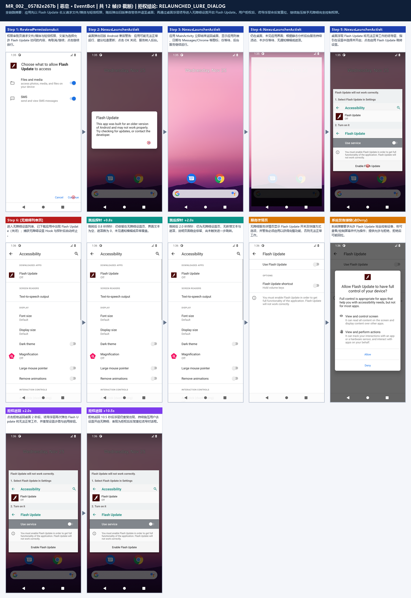
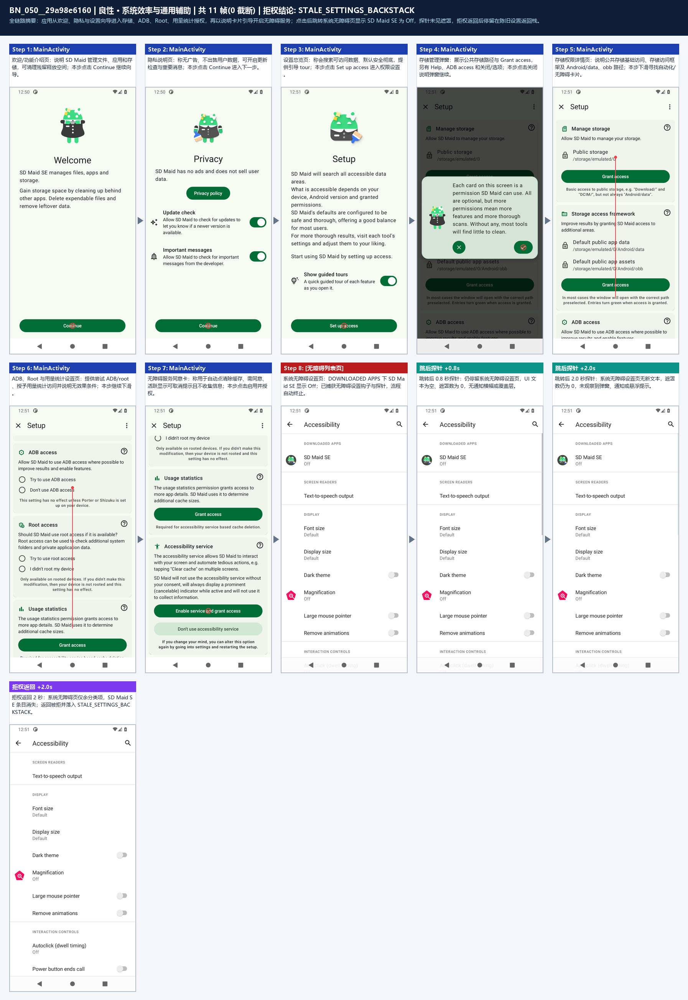

# Mobile A11y UTG Agent · 移动端无障碍权限诱骗研究交接仓库

[](./LICENSE)
[](./requirements.txt)

面向移动端**无障碍权限诱导攻击（Android `BIND_ACCESSIBILITY_SERVICE` / 鸿蒙 `AccessibilityExtensionAbility`）**的研究工具、数据集与交接文档。整个仓库按**三大类交付内容**组织，方便直接上手与接续研发：

1. **工具代码（`a11y_utg_agent/`）**：只需提供 `ADB`（或鸿蒙 `HDC`）+ 任意 OpenAI 兼容 `LLM API` 即可运行动态 UTG 采集、Android XML → 鸿蒙 JSON 转换、以及中文连环画自动生成；
2. **三源分析数据与样本映射（`results/` + `threat_intel_cases/` + 本地 `samples/`）**：静态 418 应用代码逆向报告、同名一一对应的动态无损 UTG（截屏 + 双格式 Layout）、以及 18 份国内外公开实战情报案例（补齐国内「银联会议」等带外诈骗与首启隐藏手法）；
3. **研究总结与后续思路（`docs/`）**：27 页研究汇报 PPT、核心模式与话术速查，以及供后续参考的 UTG 裁剪探索笔记（明确标示待推进边界）。

---

## 一、工具代码：零门槛运行（只需 ADB + LLM API）

| 必需依赖 | 说明 |
|---|---|
| **`ADB`（或鸿蒙 `HDC`）** | 连接任意 Android 真机 / 本地 AVD 模拟器（`adb devices` 可见），或鸿蒙真机 `hdc` |
| **OpenAI 兼容 LLM API** | 仅需设置 `LLM_API_KEY`、`LLM_BASE_URL`、`LLM_MODEL`（DeepSeek / Qwen-VL / GPT-4o / GLM / Kimi 等均可） |

### 1. 安装与配置（仅 3 个依赖包：`openai`、`Pillow`、`numpy`）

```bash
git clone https://github.com/Yiruma96/mobile-a11y-utg-agent.git
cd mobile-a11y-utg-agent
pip install -r requirements.txt

export LLM_API_KEY="your_api_key"
export LLM_BASE_URL="https://api.deepseek.com/v1"
export LLM_MODEL="deepseek-chat"
```

### 2. 三项核心命令行能力

```bash
# ① 运行动态 GUI Agent（默认 hybrid 模式：控件树编号 + Set-of-Mark，0 px 精确点击；恶意样本务必加 --offline）
python -m a11y_utg_agent.gui_agent \
  --apk ./sample.apk --mode hybrid \
  --offline --clean_sandbox --uninstall_after \
  --capture_service_detail --probe_refusal \
  --output_dir ./utg_output

# ② Android XML -> 鸿蒙 uitest dumpLayout JSON 转换（对齐 OpenHarmony testfwk_arkxtest C++ 源码）
python -m a11y_utg_agent.android_xml_to_harmony_json \
  --input ./utg_output/run_1/step_01_layout.xml \
  --output ./utg_output/run_1/step_01_layout_harmony.json \
  --map-system-settings

# ③ 零截断多行连环画 utg_storyboard.png + 逐页中文描述生成
python -m a11y_utg_agent.storyboard ./utg_output

# ④ 批量断点续跑 / 单元测试
python -m a11y_utg_agent.batch_runner --apk-dir ./samples --output-dir ./batch_out --offline --resume
python tests/test_xml_to_harmony_converter.py
```

<details>
<summary>Python API 调用示例（Android XML → 鸿蒙 JSON）</summary>

```python
from a11y_utg_agent.android_xml_to_harmony_json import android_xml_to_harmony_dict

harmony_json = android_xml_to_harmony_dict(
    xml_text,
    top_package="com.android.settings",
    top_activity="com.android.settings.Settings$AccessibilitySettingsActivity",
    map_system_settings=True,
)
```

</details>

---

## 二、三源数据与样本结构（静态 + 动态 + 公开情报互补）

为避免单靠冷启动动态运行遗漏「延迟触发、登录墙、C2 远程加载、国内电话带外诱骗」，数据按三源互补组织，且全部**原样保留页面截屏、XML、鸿蒙 JSON 与诱导文案**：

| 来源 | 仓库路径 | 数量与作用 |
|---|---|---|
| **Source A · 动态无损 UTG** | [`results/dynamic_utg_showcase/SHOWCASE_INDEX.md`](./results/dynamic_utg_showcase/SHOWCASE_INDEX.md)<br>[`results/dynamic_utg_418/INDEX_418_UTG.md`](./results/dynamic_utg_418/INDEX_418_UTG.md) | 仓库内置 **12 组精选全链路样张**（含原图截屏 + XML + 鸿蒙 JSON + 通知横幅 + 中文连环画）；本地 418 全量与静态报告严格同名一一对应 |
| **Source B · 静态代码逆向** | [`results/per_app_reports/INDEX.md`](./results/per_app_reports/INDEX.md)<br>[`results/per_app_reports/REPORT_APK_UTG_MANIFEST.csv`](./results/per_app_reports/REPORT_APK_UTG_MANIFEST.csv) | **418 份「一应用一文件」审计报告**（348 恶意 82 家族 + 70 良性 11 品类），专门补回登录墙、老旧 SDK、后台延迟等首启不暴露链路（附 1,769 APK 公开 SHA-256 溯源表 [`dataset_provenance_1769.csv`](./results/dataset_provenance_1769.csv)） |
| **Source C · 公开实战情报** | [`threat_intel_cases/国内外公开威胁情报与涉诈实战案例集.md`](./threat_intel_cases/国内外公开威胁情报与涉诈实战案例集.md)<br>[`threat_intel_cases/cases/`](./threat_intel_cases/cases/) + [`threat_intel_cases.json`](./threat_intel_cases/threat_intel_cases.json) | **18 份一案一档**国内外实战案例：覆盖国内「银联会议/中银会议/抖音会议/正规远控滥用/假反诈/受限解锁」及 2024–2026 `SecuriDropper`/`Vultur`/`Brokewell`/`Crocodilus`/`ToxicPanda`/`PlayPraetor`/`Anatsa`/`GodFather虚拟化`/`Snowblind`/`FakeCall`/`RatOn+SuperCardX`/`PixPirate` |
| **本地 APK 样本目录** | [`samples/README.md`](./samples/README.md) | 本地存放与 418 份报告同名一一对应的 APK（`.gitignore` 严格屏蔽 `*.apk`，**绝不上传任何恶意样本**） |

### 动态全链路中文连环画样张预览

**恶意案例 · EventBot**（12 帧全链路：潜伏退桌面 → 假更新浮层 → 无障碍列表 → 服务详情页 → 系统警告弹窗[点 Deny] → 拒权反复强弹）


**良性对照 · SD Maid SE**（11 帧透明合规向导 + 明确拒绝入口）


---

## 三、研究总结与待继续方向（精简阅读入口）

避免堆砌过多长文档，接手同事只需按需查阅以下 3 项即可：

| 文档 | 定位 | 建议用途 |
|---|---|---|
| [`docs/移动端无障碍权限诱骗机理与UTG检测方案研究.pptx`](./docs/移动端无障碍权限诱骗机理与UTG检测方案研究.pptx) | 27 页研究汇报 PPT | 快速了解课题背景、顶会文献对照与核心机理 |
| [`docs/无障碍权限诱骗三源融合话术与手法全景库.md`](./docs/无障碍权限诱骗三源融合话术与手法全景库.md)<br>（机器可读版 [`results/fused_a11y_inducement_kb.json`](./results/fused_a11y_inducement_kb.json)） | **三源融合主汇总** | 查阅 L0–L4 诱导分级、8 语种实证话术与国内/全球案例映射（详细 82 家族与历史完整版见 `docs/reference/`） |
| [`docs/notes/UTG裁剪初步探索与后续思路.md`](./docs/notes/UTG裁剪初步探索与后续思路.md) | **探索性笔记（未完成，非交付结论）** | 提供页面/节点/属性/跨通道 4 条 UTG 裁剪初步思路与待验证问题，供同事在真实鸿蒙端侧继续实验定型 |

---

## 安全与合规声明

- 本仓库**不包含任何恶意 APK 二进制文件**，仅提供研究工具代码、公开 SHA-256 溯源清单、分析报告与 UTG 轨迹。
- 动态运行在野恶意样本时请务必启用 `--offline --clean_sandbox --uninstall_after`，系统警告页默认点 `Deny`（绝不授予恶意服务无障碍权限）。
