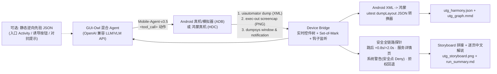

# Mobile A11y UTG Agent · 移动端无障碍权限诱骗机理研究与动态 UTG 采集套件

[](./LICENSE)
[](./requirements.txt)
[](./a11y_utg_agent/android_xml_to_harmony_json.py)

面向手机/平板**无障碍服务权限（Android `BIND_ACCESSIBILITY_SERVICE` / 鸿蒙 `AccessibilityExtensionAbility`）诱导攻击**的一体化开源研究与工具套件，包含：

1. **静态引导动态 GUI Agent（基于 GUI-Owl / Mobile-Agent-v3.5 协议）**：自动驱动 Android 模拟器/真机（`adb`）或鸿蒙真机（`hdc`），完整追踪「应用冷启动 → 诱导弹窗/WebView → 系统无障碍列表 → 跳后遮罩/通知横幅探针 → 服务详情页 → 系统完整控制警告弹窗（安全点 `Deny`）→ 拒权回退死循环探针」全链路 UTG；
2. **Android XML → 鸿蒙 `uitest dumpLayout` JSON 源码级转换器**：严格对齐 OpenHarmony 官方 `testfwk_arkxtest` C++ 源码，将 Android `uiautomator` 控件树无损转化为鸿蒙端侧检测器可直接消费的标准 JSON 格式；
3. **零截断多行视觉连环画 + 逐页中文自动解说器**：一键将整个 UTG 流程（原始截屏、点击红点标注、跳后探针、详情/警告页、拒权回退）拼接为 `utg_storyboard.png`，并由 LLM 自动为每一页外文界面生成中文翻译与行为解读；
4. **跨十年 1,769 APK / 418 份「一应用一文件」代码逆向与动态 UTG 实证成果及 27 页学术研究 PPT**（仅包含可复现 SHA-256 溯源台账、分析报告与 UTG 轨迹，绝不包含任何恶意 APK 二进制文件）。

---

## 零门槛上手：使用者只需要提供两项能力

是的——运行整套动态采集、鸿蒙格式转换与中文连环画生成，**只需要准备以下两项基础能力**：

| 必需依赖 | 说明 | 兼容范围 |
|---|---|---|
| **1. `ADB`（或鸿蒙 `HDC`）** | 已连接一台 Android 真机或本地 Android 模拟器（`adb devices` 可见） | 任意 Android 真机 / Android Studio AVD 模拟器；或鸿蒙 `hdc` |
| **2. OpenAI 兼容 LLM/VLM API** | 仅需提供 `LLM_API_KEY`、`LLM_BASE_URL`、`LLM_MODEL` | DeepSeek、Qwen-VL / Qwen-Max、GPT-4o、GLM、Kimi，或自托管 vLLM `GUI-Owl` |

> **为什么不需要专用 GUI-Owl 权重也能精准点击？**
> 本项目默认采用 **`hybrid` 混合定位模式**：每一步先通过 `adb shell uiautomator dump` 获取实时控件树并为可交互元素编号 `[1]..[N]`，同时绘制 Set-of-Mark 编号框叠加到截屏上。普通多模态或推理模型只需返回 `element_id` 即可实现 **0 px 精确点击**（同时兼容 `vision_only` 原生 GUI-Owl 0–1000 坐标模式与 `layout_only` 纯文本零图像模式）。

---

## 动态全链路实测样张（自动生成逐页中文解说连环画）

### 恶意案例 · EventBot（12 帧全链路：潜伏退桌面 → 双截图假更新浮层 → 无障碍列表 → 服务详情页 → 系统警告弹窗[点 Deny] → 拒权后浮层反复强弹）


### 恶意案例 · Hydra（8 帧全链路：假德国商业银行 4 步安全更新 → 跳后顶部通知横幅压栈 → 空描述服务详情页 → 系统警告弹窗）


### 良性对照 · SD Maid SE（11 帧透明合规流程：欢迎 → 隐私声明 → 存储/ADB/Root/Usage 选项 → 无障碍透明说明与双键选择）


> 更多精选全链路样张（含静态加密壳动态打穿案例 `TeaBot` / `Alien`、30 换行空白屏劫持 `Lucy`、伪装微信高仿设置页 `Hook`、2 秒拒权死循环 `Ermac`、零宽字符隐身 `GodFather`、良性受限设置合法教学 `Tapbar`）见 **[SHOWCASE_INDEX.md](./results/dynamic_utg_showcase/SHOWCASE_INDEX.md)**。

---

## 系统架构与核心工作流



---

## 快速安装与使用

### 1. 安装依赖（仅 3 个基础 Python 包）

```bash
git clone https://github.com/Yiruma96/mobile-a11y-utg-agent.git
cd mobile-a11y-utg-agent
pip install -r requirements.txt
```

### 2. 配置 ADB 与 LLM API

```bash
# 确认设备已连接
adb devices

# 配置任意 OpenAI 兼容 API（Linux / macOS）
export LLM_API_KEY="your_api_key"
export LLM_BASE_URL="https://api.deepseek.com/v1"   # 或 Qwen / OpenAI / GLM / 本地 vLLM 地址
export LLM_MODEL="deepseek-chat"                    # 或 qwen-vl-max / gpt-4o / deepseek-v4.1-flash

# Windows PowerShell 示例
$env:LLM_API_KEY="your_api_key"
$env:LLM_BASE_URL="https://api.openai.com/v1"
$env:LLM_MODEL="gpt-4o"
```

### 3. 运行单应用动态 GUI Agent（自动捕获完整 UTG + 鸿蒙 JSON）

```bash
# 对目标 APK 执行完整动态探索（测试恶意样本务必加 --offline --uninstall_after --clean_sandbox！）
python -m a11y_utg_agent.gui_agent \
  --apk ./sample.apk \
  --mode hybrid \
  --offline \
  --clean_sandbox \
  --uninstall_after \
  --capture_service_detail \
  --probe_refusal \
  --output_dir ./utg_output

# 若已有静态分析 JSON（如 APKAudit 产出），加 --static_json 启用「静态引导动态」模式：
python -m a11y_utg_agent.gui_agent \
  --apk ./sample.apk \
  --static_json ./sample_static.json \
  --allow_activity_fallback \
  --offline --clean_sandbox --uninstall_after \
  --output_dir ./utg_output
```

**模式切换**：
- `--mode hybrid`（默认）：同时发送 Set-of-Mark 截屏与编号控件列表，点击精度 0 px，适配任意多模态模型；
- `--mode layout_only`：仅发送纯文本控件树（零图像 Token，支持纯文本 LLM，速度最快）；
- `--mode vision_only`：纯截屏 `0–1000` 归一化坐标，兼容原生 `GUI-Owl-7B/32B` vLLM 服务；
- `--platform harmonyos --hdc-path hdc`：直接切换至鸿蒙真机原生 `uitest dumpLayout` 采集。

### 4. Android XML → 鸿蒙 `uitest dumpLayout` JSON 独立转换接口

转换器严格对齐 OpenHarmony 官方 [testfwk_arkxtest](https://gitee.com/openharmony/testfwk_arkxtest) 源码（`uitest/core/ui_model.h`、`ui_model.cpp`、`dump_handler.cpp`、`ui_driver.cpp`），输出 26 项根属性 + 30 项 `WrapperWidgetToJson` 控件属性及窗口级 `bundleName` / `abilityName` / `pagePath`，并将 Android View 类名映射至 ArkUI 组件类型（`Button`、`Text`、`Toggle`、`Checkbox`、`TextInput`、`Image`、`Web`、`Column`、`Row`、`Stack`、`List`、`Scroll`）。

**命令行调用**：
```bash
# 单文件转换（--map-system-settings 可选将 com.android.settings 映射至 com.huawei.hmos.settings）
python -m a11y_utg_agent.android_xml_to_harmony_json \
  --input ./utg_output/run_1/step_01_layout.xml \
  --output ./utg_output/run_1/step_01_layout_harmony.json \
  --map-system-settings

# 整目录批量转换所有 *_layout.xml
python -m a11y_utg_agent.android_xml_to_harmony_json --input-dir ./utg_output --map-system-settings
```

**Python API 调用**：
```python
from a11y_utg_agent.android_xml_to_harmony_json import android_xml_to_harmony_dict

harmony_json = android_xml_to_harmony_dict(
    xml_text,
    top_package="com.android.settings",
    top_activity="com.android.settings.Settings$AccessibilitySettingsActivity",
    map_system_settings=True,
)
```

### 5. 生成零截断连环画 `utg_storyboard.png` 与逐页中文解说

```bash
# 为单个运行目录或整个输出目录批量生成多行无损连环画 + 微软雅黑逐页中文说明卡片 + 更新 run_summary.md
python -m a11y_utg_agent.storyboard ./utg_output

# 若仅需拼接截图（不调用 LLM 生成中文解说）
python -m a11y_utg_agent.storyboard ./utg_output --no-zh
```

### 6. 批量 APK 自动采集（断点续跑）

```bash
python -m a11y_utg_agent.batch_runner \
  --apk-dir ./apks_folder \
  --static-dir ./optional_static_jsons \
  --output-dir ./batch_utg_output \
  --offline \
  --resume
```

### 7. 运行单元测试

```bash
python tests/test_xml_to_harmony_converter.py
```

---

## 仓库目录与研究成果索引

| 路径 | 内容说明 |
|---|---|
| [`a11y_utg_agent/`](./a11y_utg_agent/) | 全部可复用 Python 源码（`gui_agent.py`、`device_bridge.py`、`android_xml_to_harmony_json.py`、`storyboard.py`、`batch_runner.py`、`llm_client.py`） |
| [`docs/移动端无障碍权限诱骗机理与UTG检测方案研究.pptx`](./docs/移动端无障碍权限诱骗机理与UTG检测方案研究.pptx) | **27 页学术研究汇报 PPT**（涵盖三源 1,769 APK 语料溯源、7 篇顶会文献对比与一页一篇精读附录、25 条诱导模式、70 款良性工具避坑对照、双锚点五类黄金 UTG 捕获页与 99.6%/0% 回测边界） |
| [`docs/诱导用户开启无障碍行为模式清单.md`](./docs/诱导用户开启无障碍行为模式清单.md) | 面向纯 UTG 检测机制设计的 **25 条恶意行为模式清单**、**5 类黄金捕获页优先级矩阵**、**3 大良性误报雷区**与 **82 家族速查表** |
| [`docs/Android无障碍权限诱骗样本分析与正邪对照报告.md`](./docs/Android无障碍权限诱骗样本分析与正邪对照报告.md) | 跨十年（2014–2026）正邪对照完整实证分析报告 |
| [`results/dataset_provenance_1769.csv`](./results/dataset_provenance_1769.csv) | 1,769 个核验无障碍 APK 的公开来源与 SHA-256 溯源台账（MalRadar + MalwareBazaar + F-Droid / IzzyOnDroid / GitHub） |
| [`results/per_app_reports/INDEX.md`](./results/per_app_reports/INDEX.md) | **418 份「一应用一文件」代码逆向行为分析报告**（348 恶意覆盖 82/82 全家族 + 70 良性覆盖 11/11 全品类），及一一对应总表 [`REPORT_APK_UTG_MANIFEST.csv`](./results/per_app_reports/REPORT_APK_UTG_MANIFEST.csv) |
| [`samples/`](./samples/README.md) | 本地 418 款对应 APK 样本存放目录（按与报告一一对应命名；`.gitignore` 已严格屏蔽 `*.apk`，**绝不提交样本二进制至公开仓库**） |
| [`results/dynamic_utg_showcase/SHOWCASE_INDEX.md`](./results/dynamic_utg_showcase/SHOWCASE_INDEX.md) | 12 组全链路动态 UTG 精选实证集（含中文连环画 PNG、每步原始截屏、Android XML、鸿蒙 JSON 与 Mermaid UTG 流程图） |

---

## 安全与合规声明

- 本仓库**不包含任何恶意 APK 二进制文件**，仅提供防御研究代码、公开样本 SHA-256 溯源清单、脱敏分析报告与纯界面 UTG 轨迹。
- 使用本工具动态分析在野恶意软件时，**请务必在隔离模拟器中启用 `--offline --clean_sandbox --uninstall_after`**，且系统默认在系统无障碍警告弹窗阶段点击 `Deny`（绝不真正授予恶意服务无障碍权限）。
- 本项目仅限学术研究与终端防御能力建设使用。
