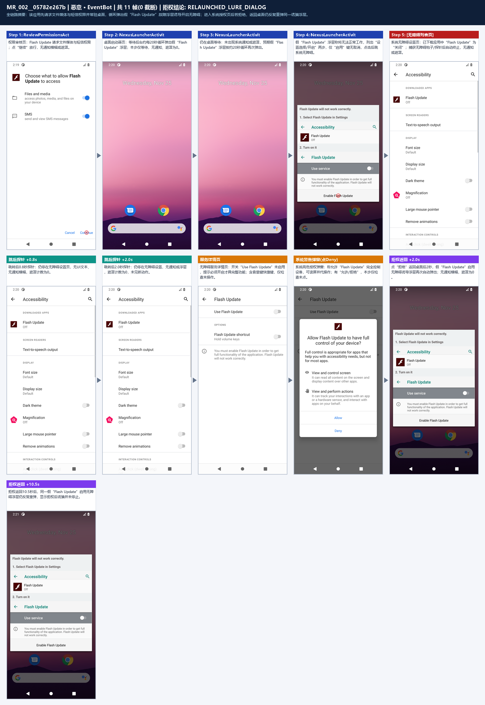
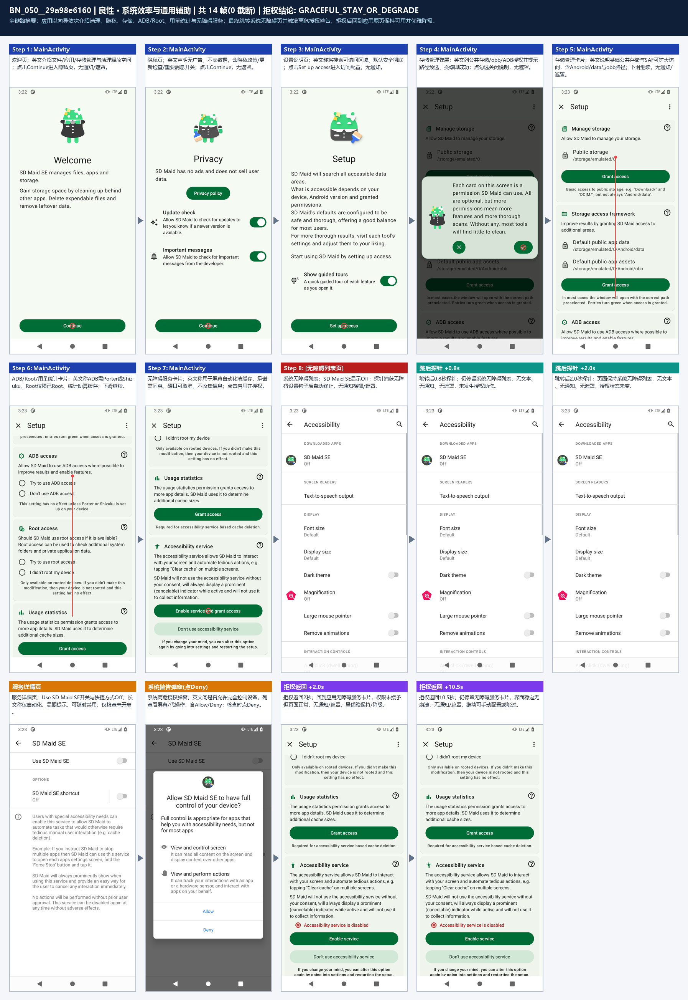

# Mobile A11y UTG Agent · 移动端无障碍权限诱导研究工具与调研结果

[](./LICENSE)
[](./requirements.txt)

本项目包含两大核心交付：**① 开箱即用的动态 UTG 采集与鸿蒙格式转换工具代码**；**② 面向 418 款实测应用（348 恶意 82 家族 + 70 良性 11 品类）与 18 份国内外公开案例的完整调研结果**，便于同事直接查阅数据、复用工具并继续开展端侧检测研发。

---

## 目录一览

```text
mobile-a11y-utg-agent/
├── a11y_utg_agent/                     # 【一、工具代码】GUI Agent + Android XML转鸿蒙JSON + 中文连环画生成
├── tests/                              # 单元测试
├── 样本库/                              # 【二、本地 APK 样本】（418 个同名样本仅存本地，.gitignore 已屏蔽绝不上传）
├── 汇报与探索笔记/                       # 【三、PPT 与后续思路】27 页研究 PPT + UTG 裁剪探索笔记（注明未完成）
└── 调研结果/                            # 【四、核心调研结果】
    ├── 诱导手法汇总.md                  #   ★ 唯一总汇总：实测样本 + 静态审计 + 网络情报的 L0–L4 分级与话术总结
    ├── 01_实测应用分析/                 #   ★ 418 款应用（一应用一文件夹，动静合一）
    │   ├── 索引总表.md
    │   ├── 恶意应用/
    │   │   ├── 01_复现无障碍页面/            (131 款：连环画 + 静态报告 + 全部原图截屏/XML/鸿蒙JSON)
    │   │   ├── 02_跑通有UTG但未触发无障碍/   (147 款：连环画 + 静态报告 + XML/鸿蒙JSON)
    │   │   └── 03_未跑通_仅静态审计/         ( 70 款：静态审计报告)
    │   └── 良性对照/
    │       ├── 01_复现无障碍授权页/          ( 38 款：合规对照，连环画 + 静态报告 + 全部原图/XML/鸿蒙JSON)
    │       ├── 02_跑通有UTG但未触发无障碍/   ( 26 款：连环画 + 静态报告 + XML/鸿蒙JSON)
    │       └── 03_未跑通_仅静态审计/         (  6 款：静态审计报告)
    └── 02_网络公开攻击手法/             #   ★ 18 份一案一档网络情报（银联/中银/抖音会议、远控滥用、海外最新木马，每篇附原文链接）
```

> **每个实测应用文件夹内部结构**：顶层仅放 `中文连环画.png`、`静态审计报告.md`、`整图UTG_鸿蒙格式.json`，零散的单步截屏、Android XML、鸿蒙 JSON 与通知/窗口遥测统一收在 `原始采集文件/` 子目录中，第一眼阅读清爽不杂乱。

---

## 一、工具快速上手（使用者只需要两项能力：ADB + LLM API）

| 必需依赖 | 说明 |
|---|---|
| **`ADB`（或鸿蒙 `HDC`）** | 连接任意 Android 真机 / 本地 AVD 模拟器（`adb devices` 可见），或鸿蒙真机 `hdc` |
| **OpenAI 兼容 LLM API** | 配置 `LLM_API_KEY`、`LLM_BASE_URL`、`LLM_MODEL`（DeepSeek / Qwen-VL / GPT-4o / GLM / Kimi 均可） |

```bash
# 1. 安装依赖（仅 openai、Pillow、numpy 三个基础包）
pip install -r requirements.txt

# 2. 配置任意 OpenAI 兼容 API
export LLM_API_KEY="your_api_key"
export LLM_BASE_URL="https://api.deepseek.com/v1"
export LLM_MODEL="deepseek-chat"

# 3. 运行动态 GUI Agent（默认 hybrid 模式：控件树编号 + Set-of-Mark，0 px 精确点击；恶意样本务必加 --offline）
python -m a11y_utg_agent.gui_agent   --apk ./sample.apk --mode hybrid   --offline --clean_sandbox --uninstall_after   --capture_service_detail --probe_refusal   --output_dir ./utg_output

# 4. Android XML -> 鸿蒙 uitest dumpLayout JSON 转换（对齐 OpenHarmony testfwk_arkxtest 源码）
python -m a11y_utg_agent.android_xml_to_harmony_json   --input ./utg_output/run_1/step_01_layout.xml   --output ./utg_output/run_1/step_01_layout_harmony.json   --map-system-settings

# 5. 生成零截断多行中文连环画（utg_storyboard.png）
python -m a11y_utg_agent.storyboard ./utg_output

# 6. 单元测试
python tests/test_xml_to_harmony_converter.py
```

---

## 二、调研结果速览入口

- **诱导手法总汇总**：[`调研结果/诱导手法汇总.md`](./调研结果/诱导手法汇总.md)（L0–L4 五级隐蔽度分层、6 大多语种话术主题与良性 70/70 防误报红线）
- **418 款实测应用分析**：[`调研结果/01_实测应用分析/索引总表.md`](./调研结果/01_实测应用分析/索引总表.md)（按复现状态分档，每应用含连环画、静态审计报告与双格式 Layout）
- **18 份网络公开案例**：[`调研结果/02_网络公开攻击手法/目录索引.md`](./调研结果/02_网络公开攻击手法/目录索引.md)（含国内「银联会议/中银会议/抖音会议/正规远控滥用」与全球 2024–2026 前沿报告，每篇附可直接点击的原文链接）
- **PPT 与探索笔记**：[`汇报与探索笔记/移动端无障碍权限诱骗机理与UTG检测方案研究.pptx`](./汇报与探索笔记/移动端无障碍权限诱骗机理与UTG检测方案研究.pptx) ｜ [`汇报与探索笔记/UTG裁剪初步探索与后续思路.md`](./汇报与探索笔记/UTG裁剪初步探索与后续思路.md)（探索性思路，非已完成结论）

### 实测中文连环画示例

**恶意案例 · EventBot**（12 帧全链路：潜伏退桌面 → 假更新浮层 → 无障碍列表 → 服务详情页 → 系统警告弹窗[安全点 Deny] → 拒权反复强弹）


**良性对照 · SD Maid SE**（完整透明引导与明确拒绝入口）


---

## 安全说明

- 本仓库**不包含任何恶意 APK 二进制文件**（本地 `样本库/` 已由 `.gitignore` 屏蔽）。
- 动态分析恶意样本请务必在隔离模拟器中加 `--offline --clean_sandbox --uninstall_after`，系统警告页默认自动点击 `Deny`。
