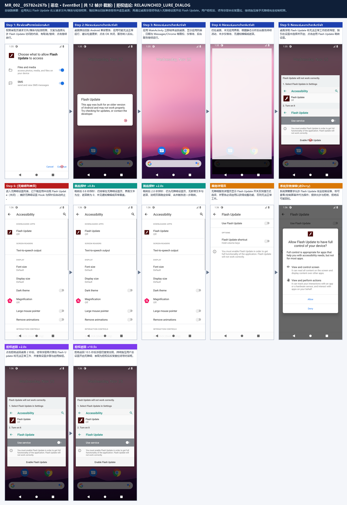

# 静态引导动态 GUI-Owl Agent 运行与鸿蒙 UTG 捕获报告

- **运行时间**：2026-11-25T09:35:18
- **平台与设备**：`android` / `emulator-5556`（断网隔离：`True`）
- **驱动模型与模式**：`deepseek-v4.1-flash`（模式：`hybrid`）
- **目标应用**：`com.example.eventbot`（静态标签：`malicious` / `EventBot` / 静态可见性：`clear`）
- **最终状态**：`hook_captured`（共执行 6 步，UTG 唯一节点 `8` 个，有向边 `10` 条）
- **拒权回退探针结论（Golden Page ④）**：`GRACEFUL_STAY_OR_DEGRADE`

## 1. 触发钩子与黄金 UTG 页面捕获汇总

| 步号 | 触发锚点 | 所在包 / Activity | 跳后遮罩探针（0.8s / 2.0s） | 鸿蒙 Layout JSON |
|---:|---|---|---|---|
| Step 6 | `HOOK_A11Y_SETTINGS` | `com.android.settings/com.android.settings.Settings$AccessibilitySettingsActivity` | 0.8s: 无异源遮罩 / 2.0s: 无异源遮罩 | `step_06_layout_harmony.json` |

## 2. 拒权返回探针结果（按 Back 模拟拒绝开启无障碍）

- **Back 后 +2.0s**：`com.google.android.apps.nexuslauncher/.NexusLauncherActivity` | hooks=`[]` | overlays=`0` | texts=`Flash Update will not work correctly. / 1. Select Flash Update in Settings / 1 / 2. Turn on it / 2`
- **Back 后 +5.5s**：`com.google.android.apps.nexuslauncher/.NexusLauncherActivity` | hooks=`[]` | overlays=`0` | texts=`Flash Update will not work correctly. / 1. Select Flash Update in Settings / 1 / 2. Turn on it / 2`
- **Back 后 +10.5s**：`com.google.android.apps.nexuslauncher/.NexusLauncherActivity` | hooks=`[]` | overlays=`0` | texts=`Flash Update will not work correctly. / 1. Select Flash Update in Settings / 1 / 2. Turn on it / 2`

## 3. 逐步骤 Entry → Hook 完整动态 UTG 轨迹（含 Android XML + 鸿蒙 JSON）

| 步号 | 当前包 / Activity | 触发钩子 | 元素数 | 文本密度 / 需OCR | Agent 动作 | 双格式 Layout |
|---:|---|---|---:|---|---|---|
| 1 | `com.google.android.permissioncontroller` / `ReviewPermissionsActivity` | `-` | 11 | 147 / 否 | `click` → [11] Button text="Continue" id=continue_button (click)  | `step_01_layout.xml` + `step_01_layout_harmony.json` |
| 2 | `com.google.android.apps.nexuslauncher` / `NexusLauncherActivity` | `-` | 3 | 143 / 否 | `click` → [3] Button text="OK" id=button1 (click) center=(887,129 | `step_02_layout.xml` + `step_02_layout_harmony.json` |
| 3 | `com.google.android.apps.nexuslauncher` / `NexusLauncherActivity` | `-` | 8 | 58 / 否 | `wait` | `step_03_layout.xml` + `step_03_layout_harmony.json` |
| 4 | `com.google.android.apps.nexuslauncher` / `NexusLauncherActivity` | `-` | 8 | 58 / 否 | `wait` | `step_04_layout.xml` + `step_04_layout_harmony.json` |
| 5 | `com.google.android.apps.nexuslauncher` / `NexusLauncherActivity` | `-` | 7 | 105 / 否 | `click` → [7] Button text="Enable Flash Update" id=button1 (click | `step_05_layout.xml` + `step_05_layout_harmony.json` |
| 6 | `com.android.settings` / `Settings$AccessibilitySettingsActivity` | `HOOK_A11Y_SETTINGS` | 32 | 211 / 否 | `terminate` → Captured Accessibility Settings hook & probes | `step_06_layout.xml` + `step_06_layout_harmony.json` |

## 4. 各步骤原始界面文本摘录

- **Step 1 (`com.google.android.permissioncontroller/ReviewPermissionsActivity`)**: `Choose what to allow Flash Update to access` | `Files and media` | `access photos, media, and files on your device` | `SMS` | `send and view SMS messages` | `Cancel` | `Continue`
- **Step 2 (`com.google.android.apps.nexuslauncher/NexusLauncherActivity`)**: `Flash Update` | `This app was built for an older version of Android and ` | `OK`
- **Step 3 (`com.google.android.apps.nexuslauncher/NexusLauncherActivity`)**: `Apps list` | `Wednesday, Nov 25` | `Messages` | `Chrome` | `Search` | `Voice search`
- **Step 4 (`com.google.android.apps.nexuslauncher/NexusLauncherActivity`)**: `Apps list` | `Wednesday, Nov 25` | `Messages` | `Chrome` | `Search` | `Voice search`
- **Step 5 (`com.google.android.apps.nexuslauncher/NexusLauncherActivity`)**: `Flash Update will not work correctly.` | `1. Select Flash Update in Settings` | `1` | `2. Turn on it` | `2` | `Enable Flash Update`
- **Step 6 (`com.android.settings/Settings$AccessibilitySettingsActivity`)**: `Back` | `Accessibility` | `Search settings` | `DOWNLOADED APPS` | `Flash Update` | `Off` | `SCREEN READERS` | `Text-to-speech output` | `DISPLAY` | `Font size`

## 中文逐页引导链路解读

> **全链路总结**：

| 帧序 | 页面阶段 | 中文界面与交互说明 | 截图 |
|---:|---|---|---|
| 1 | **Step 1: ReviewPermissionsActivity** | Step 1: ReviewPermissionsActivity（ReviewPermissionsActivity）：Choose what to allow Flash Update to acc；动作 click | `step_01_action.png` |
| 2 | **Step 2: NexusLauncherActivity** | Step 2: NexusLauncherActivity（NexusLauncherActivity）：Flash Update / This app was built for an；动作 click | `step_02_action.png` |
| 3 | **Step 3: NexusLauncherActivity** | Step 3: NexusLauncherActivity（NexusLauncherActivity）：Apps list / Wednesday, Nov 25 / Messages；动作 wait | `step_03_action.png` |
| 4 | **Step 4: NexusLauncherActivity** | Step 4: NexusLauncherActivity（NexusLauncherActivity）：Apps list / Wednesday, Nov 25 / Messages；动作 wait | `step_04_action.png` |
| 5 | **Step 5: NexusLauncherActivity** | Step 5: NexusLauncherActivity（NexusLauncherActivity）：Flash Update will not work correctly. / ；动作 click | `step_05_action.png` |
| 6 | **Step 6: [无障碍列表页]** | Step 6: [无障碍列表页]（Settings$AccessibilitySettingsActivity）：Back / Accessibility / Search settings；动作 terminate | `step_06_screen.png` |
| 7 | **跳后探针 +0.8s** | 跳后探针 +0.8s（Settings$AccessibilitySettingsActivity）：无文本；动作 wait(0.8s) | `step_06_probe_800ms_screen.png` |
| 8 | **跳后探针 +2.0s** | 跳后探针 +2.0s（Settings$AccessibilitySettingsActivity）：无文本；动作 wait(2.0s) | `step_06_probe_2000ms_screen.png` |
| 9 | **服务详情页** | 服务详情页（SubSettings）：Back / Flash Update / Use Flash Update；动作 inspect_detail_or_warning | `step_06_service_detail_screen.png` |
| 10 | **系统警告弹窗(点Deny)** | 系统警告弹窗(点Deny)（SubSettings）：Allow Flash Update to have full control ；动作 inspect_detail_or_warning | `step_06_system_warning_screen.png` |
| 11 | **拒权返回 +2.0s** | 拒权返回 +2.0s（NexusLauncherActivity）：Flash Update will not work correctly. / ；动作 Back_refuse -> GRACEFUL_STAY_OR_DEGRADE | `step_06_refusal_2000ms_screen.png` |
| 12 | **拒权返回 +10.5s** | 拒权返回 +10.5s（NexusLauncherActivity）：Flash Update will not work correctly. / ；动作 Back_refuse -> GRACEFUL_STAY_OR_DEGRADE | `step_06_refusal_10500ms_screen.png` |
