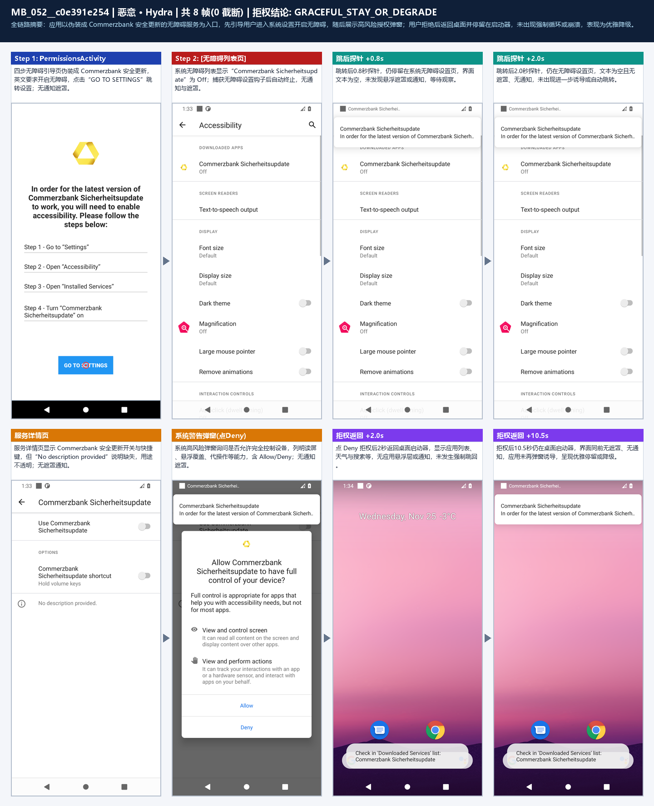

# 静态引导动态 GUI-Owl Agent 运行与鸿蒙 UTG 捕获报告

- **运行时间**：2026-11-25T09:33:24
- **平台与设备**：`android` / `emulator-5556`（断网隔离：`True`）
- **驱动模型与模式**：`deepseek-v4.1-flash`（模式：`hybrid`）
- **目标应用**：`com.grand.snail`（静态标签：`malicious` / `Hydra` / 静态可见性：`clear`）
- **最终状态**：`hook_captured`（共执行 2 步，UTG 唯一节点 `5` 个，有向边 `6` 条）
- **拒权回退探针结论（Golden Page ④）**：`GRACEFUL_STAY_OR_DEGRADE`

## 1. 触发钩子与黄金 UTG 页面捕获汇总

| 步号 | 触发锚点 | 所在包 / Activity | 跳后遮罩探针（0.8s / 2.0s） | 鸿蒙 Layout JSON |
|---:|---|---|---|---|
| Step 2 | `HOOK_A11Y_SETTINGS` | `com.android.settings/com.android.settings.Settings$AccessibilitySettingsActivity` | 0.8s: 无异源遮罩 / 2.0s: 无异源遮罩 | `step_02_layout_harmony.json` |

## 2. 拒权返回探针结果（按 Back 模拟拒绝开启无障碍）

- **Back 后 +2.0s**：`com.google.android.apps.nexuslauncher/com.google.android.apps.nexuslauncher.NexusLauncherActivity` | hooks=`[]` | overlays=`0` | texts=`Apps list / Wednesday, Nov 25 / -3°C / Snow, -3°C / Messages`
- **Back 后 +5.5s**：`com.google.android.apps.nexuslauncher/com.google.android.apps.nexuslauncher.NexusLauncherActivity` | hooks=`[]` | overlays=`0` | texts=`Apps list / Wednesday, Nov 25 / -3°C / Snow, -3°C / Messages`
- **Back 后 +10.5s**：`com.google.android.apps.nexuslauncher/com.google.android.apps.nexuslauncher.NexusLauncherActivity` | hooks=`[]` | overlays=`0` | texts=`Apps list / Wednesday, Nov 25 / -3°C / Snow, -3°C / Messages`

## 3. 逐步骤 Entry → Hook 完整动态 UTG 轨迹（含 Android XML + 鸿蒙 JSON）

| 步号 | 当前包 / Activity | 触发钩子 | 元素数 | 文本密度 / 需OCR | Agent 动作 | 双格式 Layout |
|---:|---|---|---:|---|---|---|
| 1 | `com.grand.snail` / `PermissionsActivity` | `-` | 6 | 293 / 否 | `click` → [6] Button text="GO TO SETTINGS" id=bt_goto_settings (c | `step_01_layout.xml` + `step_01_layout_harmony.json` |
| 2 | `com.android.settings` / `Settings$AccessibilitySettingsActivity` | `HOOK_A11Y_SETTINGS` | 32 | 228 / 否 | `terminate` → Captured Accessibility Settings hook & probes | `step_02_layout.xml` + `step_02_layout_harmony.json` |

## 4. 各步骤原始界面文本摘录

- **Step 1 (`com.grand.snail/PermissionsActivity`)**: `In order for the latest version of Commerzbank Sicherhe` | `Step 1 - Go to “Settings”` | `Step 2 - Open “Accessibility”` | `Step 3 - Open “Installed Services”` | `Step 4 - Turn “Commerzbank Sicherheitsupdate” on` | `GO TO SETTINGS`
- **Step 2 (`com.android.settings/Settings$AccessibilitySettingsActivity`)**: `Back` | `Accessibility` | `Search settings` | `DOWNLOADED APPS` | `Commerzbank Sicherheitsupdate` | `Off` | `SCREEN READERS` | `Text-to-speech output` | `DISPLAY` | `Font size`

## 中文逐页引导链路解读

> **全链路总结**：应用以伪装成 Commerzbank 安全更新的无障碍服务为入口，先引导用户进入系统设置开启无障碍，随后展示高风险授权弹窗；用户拒绝后返回桌面并停留在启动器，未出现强制循环或崩溃，表现为优雅降级。

**捕获到的诱导/说明话术（中译）**：
- 英语 -> “为了让最新版 Commerzbank 安全更新正常工作，您需要启用无障碍权限，请按以下步骤操作”（PermissionsActivity 四步引导页）
- 英语 -> “第1步 打开设置 / 第2步 打开无障碍 / 第3步 打开已安装服务 / 第4步 开启 Commerzbank 安全更新”（PermissionsActivity 四步引导页）
- 英语 -> “允许 Commerzbank 安全更新完全控制您的设备？”以及“可查看并控制屏幕、查看并执行操作”（系统警告弹窗）
- 英语 -> “No description provided.”（服务详情页，未说明无障碍服务真实用途）

| 帧序 | 页面阶段 | 中文界面与交互说明 | 截图 |
|---:|---|---|---|
| 1 | **Step 1: PermissionsActivity** | 四步无障碍引导页伪装成 Commerzbank 安全更新，英文要求开启无障碍，点击“GO TO SETTINGS”跳转设置；无通知遮罩。 | `step_01_action.png` |
| 2 | **Step 2: [无障碍列表页]** | 系统无障碍列表显示“Commerzbank Sicherheitsupdate”为 Off；捕获无障碍设置钩子后自动终止，无通知与遮罩。 | `step_02_screen.png` |
| 3 | **跳后探针 +0.8s** | 跳转后0.8秒探针，仍停留在系统无障碍设置页，界面文本为空，未发现悬浮遮罩或通知，等待观察。 | `step_02_probe_800ms_screen.png` |
| 4 | **跳后探针 +2.0s** | 跳转后2.0秒探针，仍在无障碍设置页，文本为空且无遮罩、无通知，未出现进一步诱导或自动跳转。 | `step_02_probe_2000ms_screen.png` |
| 5 | **服务详情页** | 服务详情页显示 Commerzbank 安全更新开关与快捷键，但“No description provided”说明缺失，用途不透明；无遮罩通知。 | `step_02_service_detail_screen.png` |
| 6 | **系统警告弹窗(点Deny)** | 系统高风险弹窗询问是否允许完全控制设备，列明读屏、悬浮覆盖、代操作等能力，含 Allow/Deny；无通知遮罩。 | `step_02_system_warning_screen.png` |
| 7 | **拒权返回 +2.0s** | 点 Deny 拒权后2秒返回桌面启动器，显示应用列表、天气与搜索等，无应用悬浮层或通知，未发生强制跳回。 | `step_02_refusal_2000ms_screen.png` |
| 8 | **拒权返回 +10.5s** | 拒权后10.5秒仍在桌面启动器，界面同前无遮罩、无通知，应用未再弹窗诱导，呈现优雅停留或降级。 | `step_02_refusal_10500ms_screen.png` |
