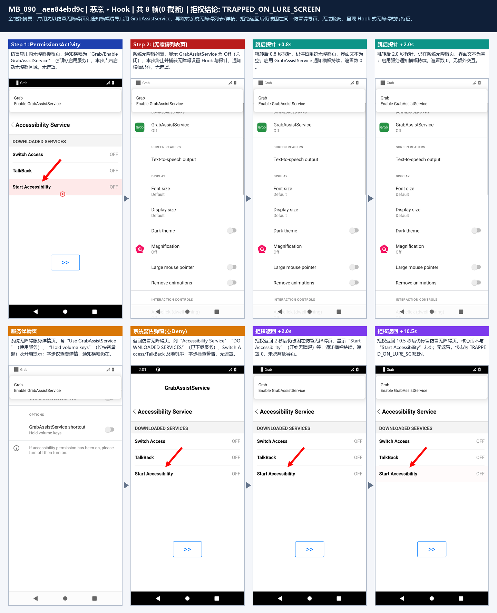

# 静态引导动态 GUI-Owl Agent 运行与鸿蒙 UTG 捕获报告

- **运行时间**：2026-11-25T10:00:33
- **平台与设备**：`android` / `emulator-5556`（断网隔离：`True`）
- **驱动模型与模式**：`deepseek-v4.1-flash`（模式：`hybrid`）
- **目标应用**：`com.tencent.mm`（静态标签：`malicious` / `Hook` / 静态可见性：`clear`）
- **最终状态**：`hook_captured`（共执行 2 步，UTG 唯一节点 `4` 个，有向边 `6` 条）
- **拒权回退探针结论（Golden Page ④）**：`GRACEFUL_STAY_OR_DEGRADE`

## 1. 触发钩子与黄金 UTG 页面捕获汇总

| 步号 | 触发锚点 | 所在包 / Activity | 跳后遮罩探针（0.8s / 2.0s） | 鸿蒙 Layout JSON |
|---:|---|---|---|---|
| Step 2 | `HOOK_A11Y_SETTINGS` | `com.android.settings/com.android.settings.Settings$AccessibilitySettingsActivity` | 0.8s: 无异源遮罩 / 2.0s: 无异源遮罩 | `step_02_layout_harmony.json` |

## 2. 拒权返回探针结果（按 Back 模拟拒绝开启无障碍）

- **Back 后 +2.0s**：`com.tencent.mm/com.xxx.zzz.PermissionsActivity` | hooks=`[]` | overlays=`0` | texts=`GrabAssistService / MH1LDiZuzhiYqAAAAAElFTkSuQmCC / Accessibility Service / DOWNLOADED SERVICES / Switch Access`
- **Back 后 +5.5s**：`com.tencent.mm/com.xxx.zzz.PermissionsActivity` | hooks=`[]` | overlays=`0` | texts=`GrabAssistService / MH1LDiZuzhiYqAAAAAElFTkSuQmCC / Accessibility Service / DOWNLOADED SERVICES / Switch Access`
- **Back 后 +10.5s**：`com.tencent.mm/com.xxx.zzz.PermissionsActivity` | hooks=`[]` | overlays=`0` | texts=`GrabAssistService / MH1LDiZuzhiYqAAAAAElFTkSuQmCC / Accessibility Service / DOWNLOADED SERVICES / Switch Access`

## 3. 逐步骤 Entry → Hook 完整动态 UTG 轨迹（含 Android XML + 鸿蒙 JSON）

| 步号 | 当前包 / Activity | 触发钩子 | 元素数 | 文本密度 / 需OCR | Agent 动作 | 双格式 Layout |
|---:|---|---|---:|---|---|---|
| 1 | `com.tencent.mm` / `PermissionsActivity` | `-` | 1 | 0 / 是 | `click` → [514, 1099] | `step_01_layout.xml` + `step_01_layout_harmony.json` |
| 2 | `com.android.settings` / `Settings$AccessibilitySettingsActivity` | `HOOK_A11Y_SETTINGS` | 32 | 216 / 否 | `terminate` → Captured Accessibility Settings hook & probes | `step_02_layout.xml` + `step_02_layout_harmony.json` |

## 4. 各步骤原始界面文本摘录

- **Step 1 (`com.tencent.mm/PermissionsActivity`)**: (空文本)
- **Step 2 (`com.android.settings/Settings$AccessibilitySettingsActivity`)**: `Back` | `Accessibility` | `Search settings` | `DOWNLOADED APPS` | `GrabAssistService` | `Off` | `SCREEN READERS` | `Text-to-speech output` | `DISPLAY` | `Font size`

## 中文逐页引导链路解读

> **全链路总结**：应用先以仿冒无障碍页和通知横幅诱导启用 GrabAssistService，再跳转系统无障碍列表/详情；拒绝返回后仍被困在同一仿冒诱导页，无法脱离，呈现 Hook 式无障碍劫持特征。

**捕获到的诱导/说明话术（中译）**：
- 英文 -> 抓取（全局通知横幅）
- 英文 -> 启用 GrabAssistService（全局通知横幅）
- 英文 -> 开始无障碍（仿冒无障碍页/拒权返回页）
- 英文 -> 若无障碍权限已开启，请先关闭再开启（系统服务详情页）
- 英文 -> 使用 GrabAssistService（系统服务详情页）
- 英文 -> 长按音量键（系统服务详情页）
- 英文 -> 已下载服务（仿冒无障碍页）
- 英文 -> 无障碍服务（仿冒无障碍页）
- 英文 -> 切换访问 关闭（仿冒无障碍页）

| 帧序 | 页面阶段 | 中文界面与交互说明 | 截图 |
|---:|---|---|---|
| 1 | **Step 1: PermissionsActivity** | 仿冒应用内无障碍授权页，通知横幅为“Grab/Enable GrabAssistService”（抓取/启用服务），本步点击启动无障碍区域，无遮罩。 | `step_01_action.png` |
| 2 | **Step 2: [无障碍列表页]** | 系统无障碍列表，显示 GrabAssistService 为 Off（关闭）；本步终止并捕获无障碍设置 Hook 与探针，通知横幅仍在，无遮罩。 | `step_02_screen.png` |
| 3 | **跳后探针 +0.8s** | 跳转后 0.8 秒探针，仍停留系统无障碍页，界面文本为空；启用 GrabAssistService 通知横幅持续，遮罩数 0。 | `step_02_probe_800ms_screen.png` |
| 4 | **跳后探针 +2.0s** | 跳转后 2.0 秒探针，仍在系统无障碍页，界面文本为空；启用服务通知横幅持续，遮罩数 0，无额外交互。 | `step_02_probe_2000ms_screen.png` |
| 5 | **服务详情页** | 系统无障碍服务详情页，含“Use GrabAssistService”（使用服务）、“Hold volume keys”（长按音量键）及开启提示；本步仅查看详情，通知横幅仍在。 | `step_02_service_detail_screen.png` |
| 6 | **系统警告弹窗(点Deny)** | 返回仿冒无障碍页，列“Accessibility Service”“DOWNLOADED SERVICES”（已下载服务）、Switch Access/TalkBack 及随机串；本步检查警告，无遮罩。 | `step_02_system_warning_screen.png` |
| 7 | **拒权返回 +2.0s** | 拒权返回 2 秒后仍被困在仿冒无障碍页，显示“Start Accessibility”（开始无障碍）等；通知横幅持续，遮罩 0，未脱离诱导页。 | `step_02_refusal_2000ms_screen.png` |
| 8 | **拒权返回 +10.5s** | 拒权返回 10.5 秒后仍停留仿冒无障碍页，核心话术与“Start Accessibility”未变；无遮罩，状态为 TRAPPED_ON_LURE_SCREEN。 | `step_02_refusal_10500ms_screen.png` |
