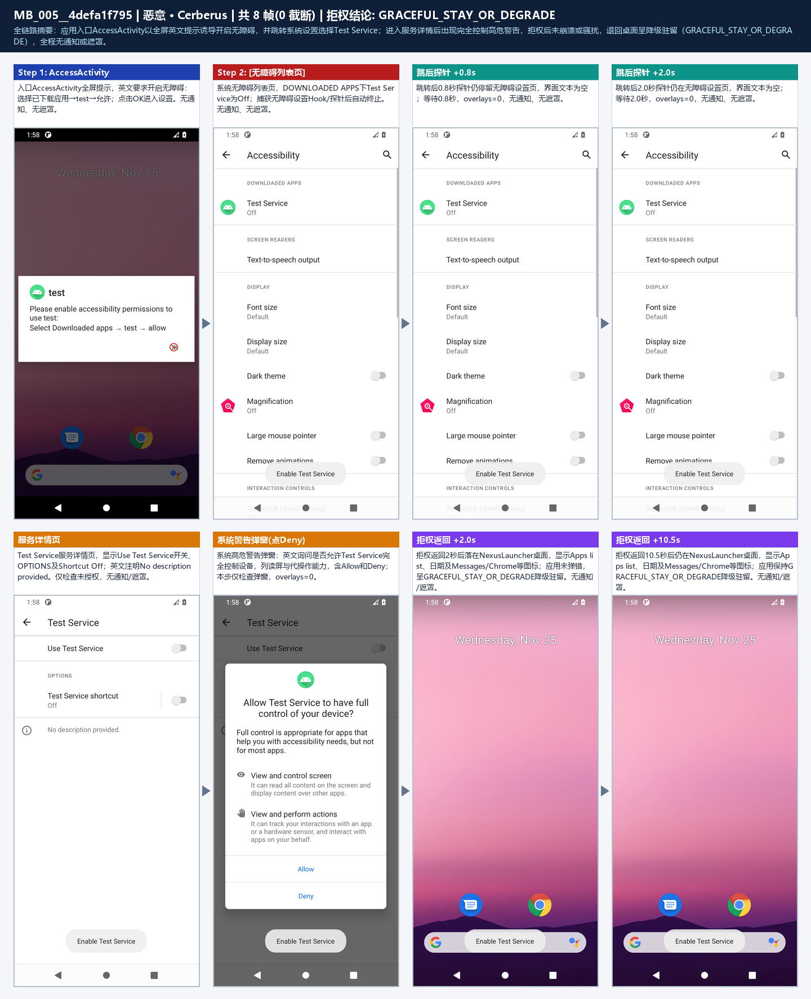

# 静态引导动态 GUI-Owl Agent 运行与鸿蒙 UTG 捕获报告

- **运行时间**：2026-11-25T09:57:57
- **平台与设备**：`android` / `emulator-5556`（断网隔离：`True`）
- **驱动模型与模式**：`deepseek-v4.1-flash`（模式：`hybrid`）
- **目标应用**：`com.framull.test`（静态标签：`malicious` / `Cerberus` / 静态可见性：`clear`）
- **最终状态**：`hook_captured`（共执行 2 步，UTG 唯一节点 `5` 个，有向边 `6` 条）
- **拒权回退探针结论（Golden Page ④）**：`GRACEFUL_STAY_OR_DEGRADE`

## 1. 触发钩子与黄金 UTG 页面捕获汇总

| 步号 | 触发锚点 | 所在包 / Activity | 跳后遮罩探针（0.8s / 2.0s） | 鸿蒙 Layout JSON |
|---:|---|---|---|---|
| Step 2 | `HOOK_A11Y_SETTINGS` | `com.android.settings/com.android.settings.Settings$AccessibilitySettingsActivity` | 0.8s: 无异源遮罩 / 2.0s: 无异源遮罩 | `step_02_layout_harmony.json` |

## 2. 拒权返回探针结果（按 Back 模拟拒绝开启无障碍）

- **Back 后 +2.0s**：`com.google.android.apps.nexuslauncher/com.google.android.apps.nexuslauncher.NexusLauncherActivity` | hooks=`[]` | overlays=`0` | texts=`Apps list / Wednesday, Nov 25 / Messages / Chrome / Search`
- **Back 后 +5.5s**：`com.google.android.apps.nexuslauncher/com.google.android.apps.nexuslauncher.NexusLauncherActivity` | hooks=`[]` | overlays=`0` | texts=`Apps list / Wednesday, Nov 25 / Messages / Chrome / Search`
- **Back 后 +10.5s**：`com.google.android.apps.nexuslauncher/com.google.android.apps.nexuslauncher.NexusLauncherActivity` | hooks=`[]` | overlays=`0` | texts=`Apps list / Wednesday, Nov 25 / Messages / Chrome / Search`

## 3. 逐步骤 Entry → Hook 完整动态 UTG 轨迹（含 Android XML + 鸿蒙 JSON）

| 步号 | 当前包 / Activity | 触发钩子 | 元素数 | 文本密度 / 需OCR | Agent 动作 | 双格式 Layout |
|---:|---|---|---:|---|---|---|
| 1 | `com.framull.test` / `AccessActivity` | `-` | 3 | 96 / 否 | `click` → [3] Button text="OK" id=button1 (click) center=(931,127 | `step_01_layout.xml` + `step_01_layout_harmony.json` |
| 2 | `com.android.settings` / `Settings$AccessibilitySettingsActivity` | `HOOK_A11Y_SETTINGS` | 32 | 211 / 否 | `terminate` → Captured Accessibility Settings hook & probes | `step_02_layout.xml` + `step_02_layout_harmony.json` |

## 4. 各步骤原始界面文本摘录

- **Step 1 (`com.framull.test/AccessActivity`)**: `test` | `Please enable accessibility permissions to use test: Se` | `OK`
- **Step 2 (`com.android.settings/Settings$AccessibilitySettingsActivity`)**: `Back` | `Accessibility` | `Search settings` | `DOWNLOADED APPS` | `Test Service` | `Off` | `SCREEN READERS` | `Text-to-speech output` | `DISPLAY` | `Font size`

## 中文逐页引导链路解读

> **全链路总结**：应用入口AccessActivity以全屏英文提示诱导开启无障碍，并跳转系统设置选择Test Service；进入服务详情后出现完全控制高危警告，拒权后未崩溃或骚扰，退回桌面呈降级驻留（GRACEFUL_STAY_OR_DEGRADE），全程无通知或遮罩。

**捕获到的诱导/说明话术（中译）**：
- English -> 请开启无障碍权限以使用test：选择“已下载的应用”→“test”→“允许”（入口AccessActivity提示页）
- English -> 允许Test Service完全控制你的设备？完全控制适用于辅助无障碍需求的App，但不适合大多数App（系统警告弹窗）
- English -> 可查看并控制屏幕：读取屏幕全部内容并覆盖显示在其他应用上（系统警告弹窗）
- English -> 可查看并执行操作：跟踪与App或硬件传感器交互，并代表你操作App（系统警告弹窗）
- English -> 未提供描述（Test Service服务详情页）

| 帧序 | 页面阶段 | 中文界面与交互说明 | 截图 |
|---:|---|---|---|
| 1 | **Step 1: AccessActivity** | 入口AccessActivity全屏提示，英文要求开启无障碍：选择已下载应用→test→允许；点击OK进入设置。无通知、无遮罩。 | `step_01_action.png` |
| 2 | **Step 2: [无障碍列表页]** | 系统无障碍列表页，DOWNLOADED APPS下Test Service为Off；捕获无障碍设置Hook/探针后自动终止。无通知、无遮罩。 | `step_02_screen.png` |
| 3 | **跳后探针 +0.8s** | 跳转后0.8秒探针仍停留无障碍设置页，界面文本为空；等待0.8秒，overlays=0，无通知、无遮罩。 | `step_02_probe_800ms_screen.png` |
| 4 | **跳后探针 +2.0s** | 跳转后2.0秒探针仍在无障碍设置页，界面文本为空；等待2.0秒，overlays=0，无通知、无遮罩。 | `step_02_probe_2000ms_screen.png` |
| 5 | **服务详情页** | Test Service服务详情页，显示Use Test Service开关、OPTIONS及Shortcut Off；英文注明No description provided。仅检查未授权，无通知/遮罩。 | `step_02_service_detail_screen.png` |
| 6 | **系统警告弹窗(点Deny)** | 系统高危警告弹窗：英文询问是否允许Test Service完全控制设备，列读屏与代操作能力，含Allow和Deny；本步仅检查弹窗，overlays=0。 | `step_02_system_warning_screen.png` |
| 7 | **拒权返回 +2.0s** | 拒权返回2秒后落在NexusLauncher桌面，显示Apps list、日期及Messages/Chrome等图标；应用未弹错，呈GRACEFUL_STAY_OR_DEGRADE降级驻留。无通知/遮罩。 | `step_02_refusal_2000ms_screen.png` |
| 8 | **拒权返回 +10.5s** | 拒权返回10.5秒后仍在NexusLauncher桌面，显示Apps list、日期及Messages/Chrome等图标；应用保持GRACEFUL_STAY_OR_DEGRADE降级驻留。无通知/遮罩。 | `step_02_refusal_10500ms_screen.png` |
