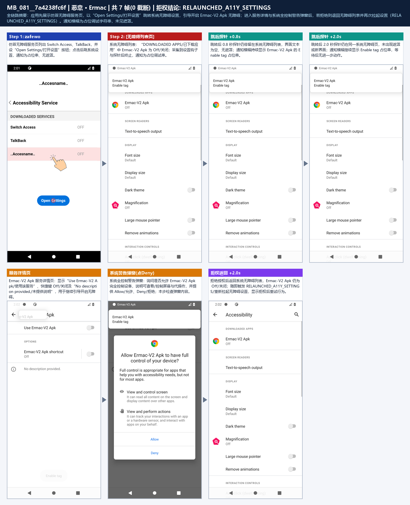

# 静态引导动态 GUI-Owl Agent 运行与鸿蒙 UTG 捕获报告

- **运行时间**：2026-11-25T10:01:51
- **平台与设备**：`android` / `emulator-5556`（断网隔离：`True`）
- **驱动模型与模式**：`deepseek-v4.1-flash`（模式：`hybrid`）
- **目标应用**：`nusku.ermacv2.apk`（静态标签：`malicious` / `Ermac` / 静态可见性：`partial_dynamic_or_remote`）
- **最终状态**：`hook_captured`（共执行 2 步，UTG 唯一节点 `4` 个，有向边 `4` 条）
- **拒权回退探针结论（Golden Page ④）**：`RELAUNCHED_A11Y_SETTINGS`

## 1. 触发钩子与黄金 UTG 页面捕获汇总

| 步号 | 触发锚点 | 所在包 / Activity | 跳后遮罩探针（0.8s / 2.0s） | 鸿蒙 Layout JSON |
|---:|---|---|---|---|
| Step 2 | `HOOK_A11Y_SETTINGS` | `com.android.settings/com.android.settings.Settings$AccessibilitySettingsActivity` | 0.8s: 无异源遮罩 / 2.0s: 无异源遮罩 | `step_02_layout_harmony.json` |

## 2. 拒权返回探针结果（按 Back 模拟拒绝开启无障碍）

- **Back 后 +2.0s**：`com.android.settings/com.android.settings.Settings$AccessibilitySettingsActivity` | hooks=`['HOOK_A11Y_SETTINGS']` | overlays=`0` | texts=`Back / Accessibility / Search settings / DOWNLOADED APPS / Ermac-V2 Apk`

## 3. 逐步骤 Entry → Hook 完整动态 UTG 轨迹（含 Android XML + 鸿蒙 JSON）

| 步号 | 当前包 / Activity | 触发钩子 | 元素数 | 文本密度 / 需OCR | Agent 动作 | 双格式 Layout |
|---:|---|---|---:|---|---|---|
| 1 | `nusku.ermacv2.apk` / `zafewo` | `-` | 13 | 125 / 否 | `click` → [13] Button text="Open Settings" (click) center=(534,15 | `step_01_layout.xml` + `step_01_layout_harmony.json` |
| 2 | `com.android.settings` / `Settings$AccessibilitySettingsActivity` | `HOOK_A11Y_SETTINGS` | 32 | 211 / 否 | `terminate` → Captured Accessibility Settings hook & probes | `step_02_layout.xml` + `step_02_layout_harmony.json` |

## 4. 各步骤原始界面文本摘录

- **Step 1 (`nusku.ermacv2.apk/zafewo`)**: `..Accesname..` | `MH1LDiZuzhiYqAAAAAElFTkSuQmCC` | `Accessibility Service` | `DOWNLOADED SERVICES` | `Switch Access` | `OFF` | `TalkBack` | `svg%3E` | `Open Settings`
- **Step 2 (`com.android.settings/Settings$AccessibilitySettingsActivity`)**: `Back` | `Accessibility` | `Search settings` | `DOWNLOADED APPS` | `Ermac-V2 Apk` | `Off` | `SCREEN READERS` | `Text-to-speech output` | `DISPLAY` | `Font size`

## 中文逐页引导链路解读

> **全链路总结**：应用先展示仿冒无障碍服务页，以“Open Settings/打开设置”跳转系统无障碍设置，引导开启 Ermac-V2 Apk 无障碍；进入服务详情与系统全控制警告弹窗后，若拒绝则退回无障碍列表并再次拉起设置（RELAUNCHED_A11Y_SETTINGS）。通知横幅为占位调试字符串，未见遮罩。

**捕获到的诱导/说明话术（中译）**：
- 英文 -> “Accessibility Service/无障碍服务”（Step 1 仿冒无障碍引导页）
- 英文 -> “Open Settings/打开设置”（Step 1 仿冒页按钮）
- 英文 -> “Use Ermac-V2 Apk/使用 Ermac-V2 Apk”（服务详情页开关）
- 英文 -> “No description provided./未提供说明”（服务详情页）
- 英文 -> “Allow Ermac-V2 Apk to have full control of your device?/允许 Ermac-V2 Apk 完全控制您的设备吗？”（系统授权警告弹窗）
- 英文 -> “Full control is appropriate for apps that help you with accessibility needs, but not for most apps./完全控制适合帮助无障碍需求的 App，但不适合大多数 App”（系统警告弹窗）
- 英文 -> “View and control screen/查看并控制屏幕”及“View and perform actions/查看并执行操作”（系统警告弹窗说明）

| 帧序 | 页面阶段 | 中文界面与交互说明 | 截图 |
|---:|---|---|---|
| 1 | **Step 1: zafewo** | 仿冒无障碍服务页列出 Switch Access、TalkBack，并设“Open Settings/打开设置”按钮；点击后跳系统设置，通知为占位串、无遮罩。 | `step_01_action.png` |
| 2 | **Step 2: [无障碍列表页]** | 系统无障碍列表：“DOWNLOADED APPS/已下载应用”中 Ermac-V2 Apk 为 Off/关闭；采集到设置钩子与探针后终止，通知为占位调试串。 | `step_02_screen.png` |
| 3 | **跳后探针 +0.8s** | 跳转后 0.8 秒探针仍停留在系统无障碍列表，界面文本为空、无遮罩；通知横幅持续显示 Ermac-V2 Apk 的 Enable tag 占位串。 | `step_02_probe_800ms_screen.png` |
| 4 | **跳后探针 +2.0s** | 跳转后 2.0 秒探针仍在同一系统无障碍页，未出现遮罩或新界面；通知横幅继续显示 Enable tag 占位串，等待后无进一步动作。 | `step_02_probe_2000ms_screen.png` |
| 5 | **服务详情页** | Ermac-V2 Apk 服务详情页：显示“Use Ermac-V2 Apk/使用该服务”、快捷键 Off/关闭及“No description provided./未提供说明”，用于继续引导开启无障碍。 | `step_02_service_detail_screen.png` |
| 6 | **系统警告弹窗(点Deny)** | 系统全控制警告弹窗：询问是否允许 Ermac-V2 Apk 完全控制设备，说明可查看/控制屏幕与代操作，并提供 Allow/允许、Deny/拒绝；本步检查弹窗内容。 | `step_02_system_warning_screen.png` |
| 7 | **拒权返回 +2.0s** | 拒绝授权后返回系统无障碍列表，Ermac-V2 Apk 仍为 Off/关闭；随即触发 RELAUNCHED_A11Y_SETTINGS/重新拉起无障碍设置，显示拒权后重试行为。 | `step_02_refusal_2000ms_screen.png` |
