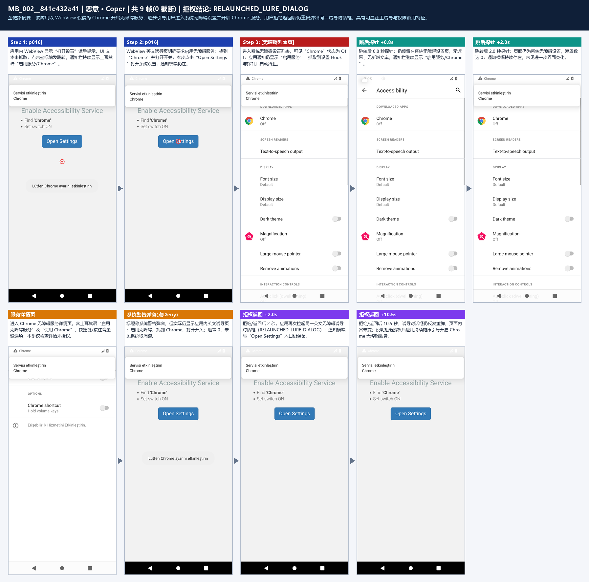

# 静态引导动态 GUI-Owl Agent 运行与鸿蒙 UTG 捕获报告

- **运行时间**：2026-11-25T10:03:25
- **平台与设备**：`android` / `emulator-5556`（断网隔离：`True`）
- **驱动模型与模式**：`deepseek-v4.1-flash`（模式：`hybrid`）
- **目标应用**：`com.beginhigh19`（静态标签：`malicious` / `Coper` / 静态可见性：`clear`）
- **最终状态**：`hook_captured`（共执行 3 步，UTG 唯一节点 `4` 个，有向边 `7` 条）
- **拒权回退探针结论（Golden Page ④）**：`RELAUNCHED_LURE_DIALOG`

## 1. 触发钩子与黄金 UTG 页面捕获汇总

| 步号 | 触发锚点 | 所在包 / Activity | 跳后遮罩探针（0.8s / 2.0s） | 鸿蒙 Layout JSON |
|---:|---|---|---|---|
| Step 3 | `HOOK_A11Y_SETTINGS` | `com.android.settings/com.android.settings.Settings$AccessibilitySettingsActivity` | 0.8s: 无异源遮罩 / 2.0s: 无异源遮罩 | `step_03_layout_harmony.json` |

## 2. 拒权返回探针结果（按 Back 模拟拒绝开启无障碍）

- **Back 后 +2.0s**：`com.beginhigh19/com.beginhigh19.p016j` | hooks=`[]` | overlays=`0` | texts=`Enable Accessibility Service / • / Find / 'Chrome' / Set switch ON`
- **Back 后 +5.5s**：`com.beginhigh19/com.beginhigh19.p016j` | hooks=`[]` | overlays=`0` | texts=`Enable Accessibility Service / • / Find / 'Chrome' / Set switch ON`
- **Back 后 +10.5s**：`com.beginhigh19/com.beginhigh19.p016j` | hooks=`[]` | overlays=`0` | texts=`Enable Accessibility Service / • / Find / 'Chrome' / Set switch ON`

## 3. 逐步骤 Entry → Hook 完整动态 UTG 轨迹（含 Android XML + 鸿蒙 JSON）

| 步号 | 当前包 / Activity | 触发钩子 | 元素数 | 文本密度 / 需OCR | Agent 动作 | 双格式 Layout |
|---:|---|---|---:|---|---|---|
| 1 | `com.beginhigh19` / `p016j` | `-` | 1 | 0 / 是 | `click` → [540, 873] | `step_01_layout.xml` + `step_01_layout_harmony.json` |
| 2 | `com.beginhigh19` / `p016j` | `-` | 8 | 67 / 否 | `click` → [8] Button text="Open Settings" id=t_openSettings (clic | `step_02_layout.xml` + `step_02_layout_harmony.json` |
| 3 | `com.android.settings` / `Settings$AccessibilitySettingsActivity` | `HOOK_A11Y_SETTINGS` | 32 | 205 / 否 | `terminate` → Captured Accessibility Settings hook & probes | `step_03_layout.xml` + `step_03_layout_harmony.json` |

## 4. 各步骤原始界面文本摘录

- **Step 1 (`com.beginhigh19/p016j`)**: (空文本)
- **Step 2 (`com.beginhigh19/p016j`)**: `Enable Accessibility Service` | `•` | `Find` | `'Chrome'` | `Set switch ON` | `Open Settings`
- **Step 3 (`com.android.settings/Settings$AccessibilitySettingsActivity`)**: `Back` | `Accessibility` | `Search settings` | `DOWNLOADED APPS` | `Chrome` | `Off` | `SCREEN READERS` | `Text-to-speech output` | `DISPLAY` | `Font size`

## 中文逐页引导链路解读

> **全链路总结**：该应用以 WebView 假借为 Chrome 开启无障碍服务，逐步引导用户进入系统无障碍设置并开启 Chrome 服务；用户拒绝返回后仍重复弹出同一诱导对话框，具有明显社工诱导与权限滥用特征。

**捕获到的诱导/说明话术（中译）**：
- Enable Accessibility Service • Find 'Chrome' Set switch ON Open Settings（英文） -> 启用无障碍服务：找到“Chrome”并打开开关，点“打开设置”（WebView 诱导页/拒权后重弹页）
- Erişebilirlik Hizmetini Etkinleştirin.（土耳其语） -> 启用无障碍服务（Chrome 服务详情页）
- Servisi etkinleştirin / Chrome（土耳其语通知） -> 启用服务 / Chrome（贯穿各页的通知横幅）

| 帧序 | 页面阶段 | 中文界面与交互说明 | 截图 |
|---:|---|---|---|
| 1 | **Step 1: p016j** | 应用内 WebView 显示“打开设置”诱导提示，UI 文本未抓取；点击坐标触发跳转，通知栏持续显示土耳其语“启用服务/Chrome”。 | `step_01_action.png` |
| 2 | **Step 2: p016j** | WebView 英文诱导页明确要求启用无障碍服务：找到“Chrome”并打开开关；本步点击“Open Settings”打开系统设置，通知横幅仍在。 | `step_02_action.png` |
| 3 | **Step 3: [无障碍列表页]** | 进入系统无障碍设置列表，可见“Chrome”状态为 Off；应用通知仍显示“启用服务”，抓取到设置 Hook 与探针后自动终止。 | `step_03_screen.png` |
| 4 | **跳后探针 +0.8s** | 跳转后 0.8 秒探针：仍停留在系统无障碍设置页，无遮罩、无新增文案；通知栏继续显示“启用服务/Chrome”。 | `step_03_probe_800ms_screen.png` |
| 5 | **跳后探针 +2.0s** | 跳转后 2.0 秒探针：页面仍为系统无障碍设置，遮罩数为 0；通知横幅持续存在，未见进一步界面变化。 | `step_03_probe_2000ms_screen.png` |
| 6 | **服务详情页** | 进入 Chrome 无障碍服务详情页，含土耳其语“启用无障碍服务”及“使用 Chrome”、快捷键/按住音量键选项；本步仅检查详情未授权。 | `step_03_service_detail_screen.png` |
| 7 | **系统警告弹窗(点Deny)** | 标题称系统警告弹窗，但实际仍显示应用内英文诱导页：启用无障碍、找到 Chrome、打开开关；遮罩 0，未见系统取消键。 | `step_03_system_warning_screen.png` |
| 8 | **拒权返回 +2.0s** | 拒绝/返回后 2 秒，应用再次拉起同一英文无障碍诱导对话框（RELAUNCHED_LURE_DIALOG）；通知横幅与“Open Settings”入口仍保留。 | `step_03_refusal_2000ms_screen.png` |
| 9 | **拒权返回 +10.5s** | 拒绝/返回后 10.5 秒，诱导对话框仍反复重弹，页面内容未变；说明拒绝授权后应用持续施压引导开启 Chrome 无障碍服务。 | `step_03_refusal_10500ms_screen.png` |
