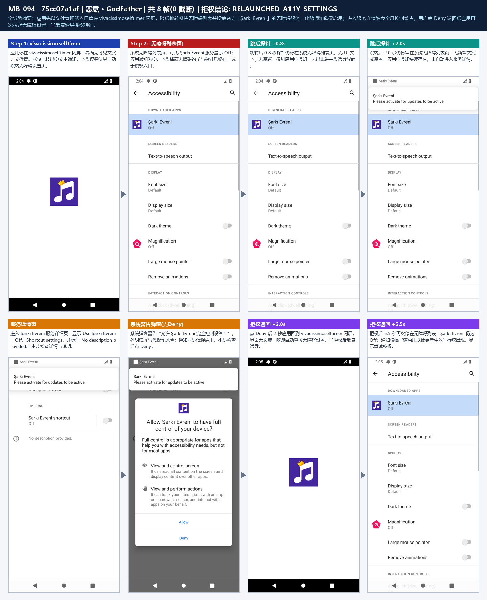

# 静态引导动态 GUI-Owl Agent 运行与鸿蒙 UTG 捕获报告

- **运行时间**：2026-11-25T10:04:37
- **平台与设备**：`android` / `emulator-5556`（断网隔离：`True`）
- **驱动模型与模式**：`deepseek-v4.1-flash`（模式：`hybrid`）
- **目标应用**：`com.alphainventor.filemanager`（静态标签：`malicious` / `GodFather` / 静态可见性：`clear`）
- **最终状态**：`hook_captured`（共执行 2 步，UTG 唯一节点 `4` 个，有向边 `5` 条）
- **拒权回退探针结论（Golden Page ④）**：`RELAUNCHED_A11Y_SETTINGS`

## 1. 触发钩子与黄金 UTG 页面捕获汇总

| 步号 | 触发锚点 | 所在包 / Activity | 跳后遮罩探针（0.8s / 2.0s） | 鸿蒙 Layout JSON |
|---:|---|---|---|---|
| Step 2 | `HOOK_A11Y_SETTINGS` | `com.android.settings/com.android.settings.Settings$AccessibilitySettingsActivity` | 0.8s: 无异源遮罩 / 2.0s: 无异源遮罩 | `step_02_layout_harmony.json` |

## 2. 拒权返回探针结果（按 Back 模拟拒绝开启无障碍）

- **Back 后 +2.0s**：`com.alphainventor.filemanager/com.alphainventor.filemanager.Activitys.vivacissimoselftimer` | hooks=`[]` | overlays=`0` | texts=``
- **Back 后 +5.5s**：`com.android.settings/com.android.settings.Settings$AccessibilitySettingsActivity` | hooks=`['HOOK_A11Y_SETTINGS']` | overlays=`0` | texts=`Back / Accessibility / Search settings / DOWNLOADED APPS / Ş‎a‎r‎k‎ı E‎v‎r‎e‎n‎i`

## 3. 逐步骤 Entry → Hook 完整动态 UTG 轨迹（含 Android XML + 鸿蒙 JSON）

| 步号 | 当前包 / Activity | 触发钩子 | 元素数 | 文本密度 / 需OCR | Agent 动作 | 双格式 Layout |
|---:|---|---|---:|---|---|---|
| 1 | `com.alphainventor.filemanager` / `vivacissimoselftimer` | `-` | 0 | 0 / 否 | `wait` | `step_01_layout.xml` + `step_01_layout_harmony.json` |
| 2 | `com.android.settings` / `Settings$AccessibilitySettingsActivity` | `HOOK_A11Y_SETTINGS` | 32 | 220 / 否 | `terminate` → Captured Accessibility Settings hook & probes | `step_02_layout.xml` + `step_02_layout_harmony.json` |

## 4. 各步骤原始界面文本摘录

- **Step 1 (`com.alphainventor.filemanager/vivacissimoselftimer`)**: (空文本)
- **Step 2 (`com.android.settings/Settings$AccessibilitySettingsActivity`)**: `Back` | `Accessibility` | `Search settings` | `DOWNLOADED APPS` | `Ş‎a‎r‎k‎ı E‎v‎r‎e‎n‎i` | `Off` | `SCREEN READERS` | `Text-to-speech output` | `DISPLAY` | `Font size`

## 中文逐页引导链路解读

> **全链路总结**：应用先以文件管理器入口停在 vivacissimoselftimer 闪屏，随后跳转系统无障碍列表并投放名为「Şarkı Evreni」的无障碍服务，伴随通知催促启用；进入服务详情触发全屏控制警告，用户点 Deny 返回后应用再次拉起无障碍设置，呈反复诱导授权特征。

**捕获到的诱导/说明话术（中译）**：
- English -> “Please activate for updates to be active”＝“请启用以便更新生效”（授权弹窗、拒权后无障碍列表页的通知横幅）
- English -> “No description provided.”＝“未提供描述”（服务详情页，无障碍服务说明缺失）
- Turkish/服务名“Şarkı Evreni” -> 中文“歌曲宇宙”（无障碍列表、服务详情与授权弹窗，服务名被用作伪装）

| 帧序 | 页面阶段 | 中文界面与交互说明 | 截图 |
|---:|---|---|---|
| 1 | **Step 1: vivacissimoselftimer** | 应用停在 vivacissimoselftimer 闪屏，界面无可见文案；文件管理器包已挂出空文本通知，本步仅等待其自动跳转无障碍设置页。 | `step_01_action.png` |
| 2 | **Step 2: [无障碍列表页]** | 系统无障碍列表页，可见 Şarkı Evreni 服务显示 Off；应用通知为空。本步捕获无障碍钩子与探针后终止，属于授权入口。 | `step_02_screen.png` |
| 3 | **跳后探针 +0.8s** | 跳转后 0.8 秒探针仍停在系统无障碍列表页，无 UI 文本、无遮罩；仅见应用空通知，未出现进一步诱导界面。 | `step_02_probe_800ms_screen.png` |
| 4 | **跳后探针 +2.0s** | 跳转后 2.0 秒仍停留在系统无障碍列表页，无新增文案或遮罩；应用空通知持续存在，未自动进入服务详情。 | `step_02_probe_2000ms_screen.png` |
| 5 | **服务详情页** | 进入 Şarkı Evreni 服务详情页，显示 Use Şarkı Evreni、Off、Shortcut settings，并标注 No description provided.；本步检查详情与说明。 | `step_02_service_detail_screen.png` |
| 6 | **系统警告弹窗(点Deny)** | 系统弹窗警告“允许 Şarkı Evreni 完全控制设备？”，列明读屏与代操作风险；通知同步催促启用，本步检查后点 Deny。 | `step_02_system_warning_screen.png` |
| 7 | **拒权返回 +2.0s** | 点 Deny 后 2 秒应用回到 vivacissimoselftimer 闪屏，界面无文案；随即自动重拉无障碍设置，呈拒权后反复诱导。 | `step_02_refusal_2000ms_screen.png` |
| 8 | **拒权返回 +5.5s** | 拒权后 5.5 秒再次停在无障碍列表，Şarkı Evreni 仍为 Off；通知横幅“请启用以便更新生效”持续出现，显示重试拉权。 | `step_02_refusal_5500ms_screen.png` |
