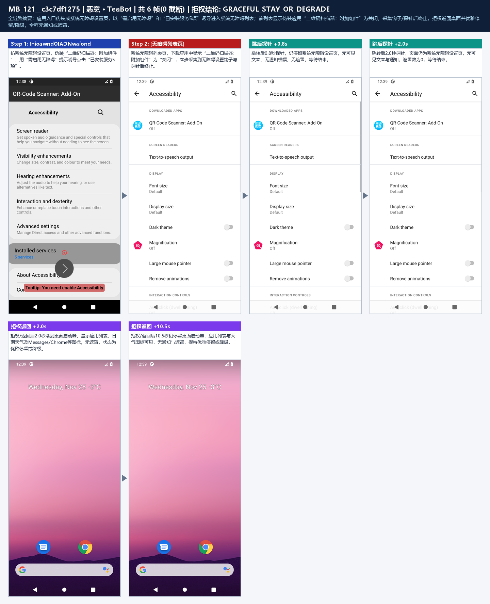

# 静态引导动态 GUI-Owl Agent 运行与鸿蒙 UTG 捕获报告

- **运行时间**：2026-11-25T08:38:56
- **平台与设备**：`android` / `emulator-5556`（断网隔离：`True`）
- **驱动模型与模式**：`deepseek-v4.1-flash`（模式：`hybrid`）
- **目标应用**：`com.bracket.original`（静态标签：`malicious` / `TeaBot` / 静态可见性：`packed_or_encrypted`）
- **最终状态**：`hook_captured`（共执行 2 步，UTG 唯一节点 `3` 个，有向边 `4` 条）
- **拒权回退探针结论（Golden Page ④）**：`GRACEFUL_STAY_OR_DEGRADE`

## 1. 触发钩子与黄金 UTG 页面捕获汇总

| 步号 | 触发锚点 | 所在包 / Activity | 跳后遮罩探针（0.8s / 2.0s） | 鸿蒙 Layout JSON |
|---:|---|---|---|---|
| Step 2 | `HOOK_A11Y_SETTINGS` | `com.android.settings/com.android.settings.Settings$AccessibilitySettingsActivity` | 0.8s: 无异源遮罩 / 2.0s: 无异源遮罩 | `step_02_layout_harmony.json` |

## 2. 拒权返回探针结果（按 Back 模拟拒绝开启无障碍）

- **Back 后 +2.0s**：`com.google.android.apps.nexuslauncher/com.google.android.apps.nexuslauncher.NexusLauncherActivity` | hooks=`[]` | overlays=`0` | texts=`Apps list / Wednesday, Nov 25 / -3°C / Snow, -3°C / Messages`
- **Back 后 +5.5s**：`com.google.android.apps.nexuslauncher/com.google.android.apps.nexuslauncher.NexusLauncherActivity` | hooks=`[]` | overlays=`0` | texts=`Apps list / Wednesday, Nov 25 / -3°C / Snow, -3°C / Messages`
- **Back 后 +10.5s**：`com.google.android.apps.nexuslauncher/com.google.android.apps.nexuslauncher.NexusLauncherActivity` | hooks=`[]` | overlays=`0` | texts=`Apps list / Wednesday, Nov 25 / -3°C / Snow, -3°C / Messages`

## 3. 逐步骤 Entry → Hook 完整动态 UTG 轨迹（含 Android XML + 鸿蒙 JSON）

| 步号 | 当前包 / Activity | 触发钩子 | 元素数 | 文本密度 / 需OCR | Agent 动作 | 双格式 Layout |
|---:|---|---|---:|---|---|---|
| 1 | `com.bracket.original` / `InioawndOIADNwaiond` | `-` | 12 | 562 / 否 | `click` → [9] View text="Installed services5 services" id=this ce | `step_01_layout.xml` + `step_01_layout_harmony.json` |
| 2 | `com.android.settings` / `Settings$AccessibilitySettingsActivity` | `HOOK_A11Y_SETTINGS` | 32 | 222 / 否 | `terminate` → Captured Accessibility Settings hook & probes | `step_02_layout.xml` + `step_02_layout_harmony.json` |

## 4. 各步骤原始界面文本摘录

- **Step 1 (`com.bracket.original/InioawndOIADNwaiond`)**: `QR-Code Scanner: Add-On` | `Accessibility` | `Screen readerGet spoken audio guidance and special cont` | `Visibility enhancementsChange size, contrast, and colou` | `Hearing enhancementsAdjust the audio to help your heari` | `Interaction and dexterityEnhance or replace touch inter` | `Advanced settingsManage Direct access and other advance` | `Installed services5 services` | `About Accessibility` | `Contact Us`
- **Step 2 (`com.android.settings/Settings$AccessibilitySettingsActivity`)**: `Back` | `Accessibility` | `Search settings` | `DOWNLOADED APPS` | `QR-Code Scanner: Add-On` | `Off` | `SCREEN READERS` | `Text-to-speech output` | `DISPLAY` | `Font size`

## 中文逐页引导链路解读

> **全链路总结**：应用入口伪装成系统无障碍设置页，以“需启用无障碍”和“已安装服务5项”诱导进入系统无障碍列表；该列表显示伪装应用“二维码扫描器：附加组件”为关闭，采集钩子/探针后终止，拒权返回桌面并优雅停留/降级，全程无通知或遮罩。

**捕获到的诱导/说明话术（中译）**：
- 英文 “Tooltip: You need enable Accessibility” -> 中文核心意译“提示：你需要启用无障碍”（步骤1仿无障碍设置页）
- 英文 “Installed services5 services” -> 中文核心意译“已安装的服务5项”（步骤1，诱导点击进入系统无障碍列表）
- 英文 “QR-Code Scanner: Add-On” -> 中文核心意译“二维码扫描器：附加组件”（步骤1/步骤2伪装应用名）

| 帧序 | 页面阶段 | 中文界面与交互说明 | 截图 |
|---:|---|---|---|
| 1 | **Step 1: InioawndOIADNwaiond** | 仿系统无障碍设置页，伪装“二维码扫描器：附加组件”，用“需启用无障碍”提示诱导点击“已安装服务5项”。 | `step_01_action.png` |
| 2 | **Step 2: [无障碍列表页]** | 系统无障碍列表页，下载应用中显示“二维码扫描器：附加组件”为“关闭”，本步采集到无障碍设置钩子与探针后终止。 | `step_02_screen.png` |
| 3 | **跳后探针 +0.8s** | 跳转后0.8秒探针，仍停留系统无障碍设置页，无可见文本、无通知横幅、无遮罩，等待结束。 | `step_02_probe_800ms_screen.png` |
| 4 | **跳后探针 +2.0s** | 跳转后2.0秒探针，页面仍为系统无障碍设置页，无可见文本与通知，遮罩数为0，等待结束。 | `step_02_probe_2000ms_screen.png` |
| 5 | **拒权返回 +2.0s** | 拒权/返回后2.0秒落到桌面启动器，显示应用列表、日期天气及Messages/Chrome等图标，无遮罩，状态为优雅停留或降级。 | `step_02_refusal_2000ms_screen.png` |
| 6 | **拒权返回 +10.5s** | 拒权/返回后10.5秒仍停留桌面启动器，应用列表与天气图标可见，无通知与遮罩，保持优雅停留或降级。 | `step_02_refusal_10500ms_screen.png` |
