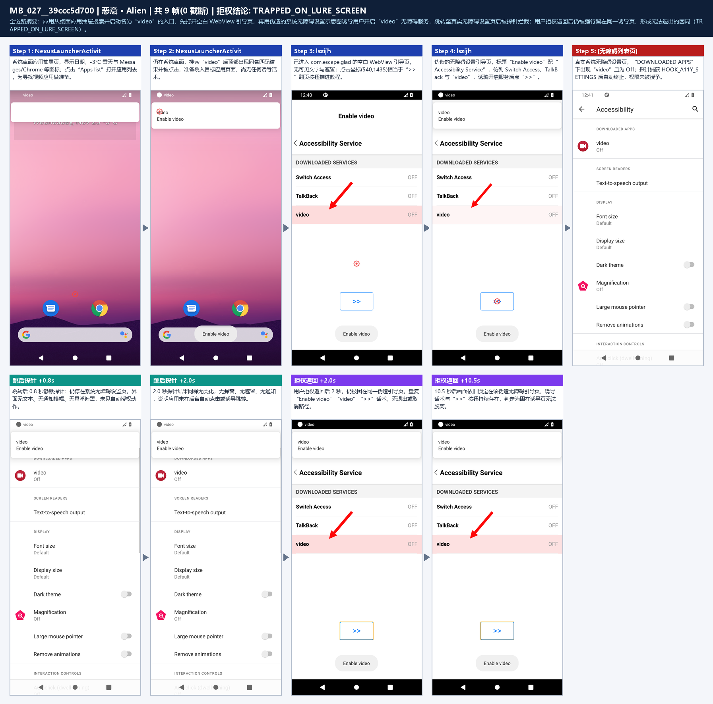

# 静态引导动态 GUI-Owl Agent 运行与鸿蒙 UTG 捕获报告

- **运行时间**：2026-11-25T08:40:31
- **平台与设备**：`android` / `emulator-5556`（断网隔离：`True`）
- **驱动模型与模式**：`deepseek-v4.1-flash`（模式：`hybrid`）
- **目标应用**：`com.escape.glad`（静态标签：`malicious` / `Alien` / 静态可见性：`packed_or_encrypted`）
- **最终状态**：`hook_captured`（共执行 5 步，UTG 唯一节点 `4` 个，有向边 `7` 条）
- **拒权回退探针结论（Golden Page ④）**：`GRACEFUL_STAY_OR_DEGRADE`

## 1. 触发钩子与黄金 UTG 页面捕获汇总

| 步号 | 触发锚点 | 所在包 / Activity | 跳后遮罩探针（0.8s / 2.0s） | 鸿蒙 Layout JSON |
|---:|---|---|---|---|
| Step 5 | `HOOK_A11Y_SETTINGS` | `com.android.settings/com.android.settings.Settings$AccessibilitySettingsActivity` | 0.8s: 无异源遮罩 / 2.0s: 无异源遮罩 | `step_05_layout_harmony.json` |

## 2. 拒权返回探针结果（按 Back 模拟拒绝开启无障碍）

- **Back 后 +2.0s**：`com.escape.glad/com.mhiauaqmlacl.ypmsfwbkjhsbeoz.lszijh` | hooks=`[]` | overlays=`0` | texts=`Enable video / MH1LDiZuzhiYqAAAAAElFTkSuQmCC / Accessibility Service / DOWNLOADED SERVICES / Switch Access`
- **Back 后 +5.5s**：`com.escape.glad/com.mhiauaqmlacl.ypmsfwbkjhsbeoz.lszijh` | hooks=`[]` | overlays=`0` | texts=`Enable video / MH1LDiZuzhiYqAAAAAElFTkSuQmCC / Accessibility Service / DOWNLOADED SERVICES / Switch Access`
- **Back 后 +10.5s**：`com.escape.glad/com.mhiauaqmlacl.ypmsfwbkjhsbeoz.lszijh` | hooks=`[]` | overlays=`0` | texts=`Enable video / MH1LDiZuzhiYqAAAAAElFTkSuQmCC / Accessibility Service / DOWNLOADED SERVICES / Switch Access`

## 3. 逐步骤 Entry → Hook 完整动态 UTG 轨迹（含 Android XML + 鸿蒙 JSON）

| 步号 | 当前包 / Activity | 触发钩子 | 元素数 | 文本密度 / 需OCR | Agent 动作 | 双格式 Layout |
|---:|---|---|---:|---|---|---|
| 1 | `com.google.android.apps.nexuslauncher` / `NexusLauncherActivity` | `-` | 9 | 72 / 否 | `click` → [1] View desc="Apps list" (click) center=(540,1688) | `step_01_layout.xml` + `step_01_layout_harmony.json` |
| 2 | `com.google.android.apps.nexuslauncher` / `NexusLauncherActivity` | `-` | 9 | 72 / 否 | `click` → [76, 180] | `step_02_layout.xml` + `step_02_layout_harmony.json` |
| 3 | `com.escape.glad` / `lszijh` | `-` | 1 | 0 / 是 | `click` → [540, 1435] | `step_03_layout.xml` + `step_03_layout_harmony.json` |
| 4 | `com.escape.glad` / `lszijh` | `-` | 13 | 143 / 否 | `click` → [13] Button text=">>" (click) center=(540,1747) | `step_04_layout.xml` + `step_04_layout_harmony.json` |
| 5 | `com.android.settings` / `Settings$AccessibilitySettingsActivity` | `HOOK_A11Y_SETTINGS` | 32 | 204 / 否 | `terminate` → Captured Accessibility Settings hook & probes | `step_05_layout.xml` + `step_05_layout_harmony.json` |

## 4. 各步骤原始界面文本摘录

- **Step 1 (`com.google.android.apps.nexuslauncher/NexusLauncherActivity`)**: `Apps list` | `Wednesday, Nov 25` | `-3°C` | `Snow, -3°C` | `Messages` | `Chrome` | `Search` | `Voice search`
- **Step 2 (`com.google.android.apps.nexuslauncher/NexusLauncherActivity`)**: `Apps list` | `Wednesday, Nov 25` | `-3°C` | `Snow, -3°C` | `Messages` | `Chrome` | `Search` | `Voice search`
- **Step 3 (`com.escape.glad/lszijh`)**: (空文本)
- **Step 4 (`com.escape.glad/lszijh`)**: `Enable video` | `MH1LDiZuzhiYqAAAAAElFTkSuQmCC` | `Accessibility Service` | `DOWNLOADED SERVICES` | `Switch Access` | `OFF` | `TalkBack` | `K6CMNwLsAuD4wKnaBOVoIzOTDaf4TaJ` | `video` | `>>`
- **Step 5 (`com.android.settings/Settings$AccessibilitySettingsActivity`)**: `Back` | `Accessibility` | `Search settings` | `DOWNLOADED APPS` | `video` | `Off` | `SCREEN READERS` | `Text-to-speech output` | `DISPLAY` | `Font size`

## 中文逐页引导链路解读

> **全链路总结**：应用从桌面应用抽屉搜索并启动名为“video”的入口，先打开空白 WebView 引导页，再用伪造的系统无障碍设置示意图诱导用户开启“video”无障碍服务，跳转至真实无障碍设置页后被探针拦截；用户拒权返回后仍被强行留在同一诱导页，形成无法退出的困局（TRAPPED_ON_LURE_SCREEN）。

**捕获到的诱导/说明话术（中译）**：
- 英文 "Enable video" -> 中文意译“启用 video（无障碍服务）”（伪造无障碍引导页，页面主标题式诱导）
- 英文 "Accessibility Service" -> 中文意译“无障碍服务”（伪造引导页以系统术语伪装，暗示需授权）
- 英文 "DOWNLOADED SERVICES / Switch Access / TalkBack / OFF" -> 中文意译“已下载的服务：切换访问、TalkBack、关闭”（仿冒系统设置列表，用真实辅助功能名称增加可信度）
- 英文 "video" -> 中文意译“video”（诱导目标条目，与真实系统设置中出现的同名条目呼应）
- 符号 ">>" -> 中文意译“下一步/继续”（伪装成教程翻页按钮，实为推进授权诱导）

| 帧序 | 页面阶段 | 中文界面与交互说明 | 截图 |
|---:|---|---|---|
| 1 | **Step 1: NexusLauncherActivity** | 系统桌面应用抽屉页，显示日期、-3°C 雪天与 Messages/Chrome 等图标；点击“Apps list”打开应用列表，为寻找视频应用做准备。 | `step_01_action.png` |
| 2 | **Step 2: NexusLauncherActivity** | 仍在系统桌面，搜索“video”后顶部出现同名匹配结果并被点击，准备跳入目标应用页面，尚无任何诱导话术。 | `step_02_action.png` |
| 3 | **Step 3: lszijh** | 已进入 com.escape.glad 的空白 WebView 引导页，无可见文字与遮罩；点击坐标(540,1435)相当于“>>”翻页按钮推进教程。 | `step_03_action.png` |
| 4 | **Step 4: lszijh** | 伪造的无障碍设置引导页，标题“Enable video”配“Accessibility Service”，仿列 Switch Access、TalkBack 与“video”，诱骗开启服务后点“>>”。 | `step_04_action.png` |
| 5 | **Step 5: [无障碍列表页]** | 真实系统无障碍设置页，“DOWNLOADED APPS”下出现“video”且为 Off；探针捕获 HOOK_A11Y_SETTINGS 后自动终止，权限未被授予。 | `step_05_screen.png` |
| 6 | **跳后探针 +0.8s** | 跳转后 0.8 秒静默探针：仍停在系统无障碍设置页，界面无文本、无通知横幅、无悬浮遮罩，未见自动授权动作。 | `step_05_probe_800ms_screen.png` |
| 7 | **跳后探针 +2.0s** | 2.0 秒探针结果同样无变化，无弹窗、无遮罩、无通知，说明应用未在后台自动点击或诱导跳转。 | `step_05_probe_2000ms_screen.png` |
| 8 | **拒权返回 +2.0s** | 用户拒权返回后 2 秒，仍被困在同一伪造引导页，重复“Enable video”“video”“>>”话术，无退出或取消路径。 | `step_05_refusal_2000ms_screen.png` |
| 9 | **拒权返回 +10.5s** | 10.5 秒后画面依旧锁定在该伪造无障碍引导页，诱导话术与“>>”按钮持续存在，判定为困在诱导页无法脱离。 | `step_05_refusal_10500ms_screen.png` |
