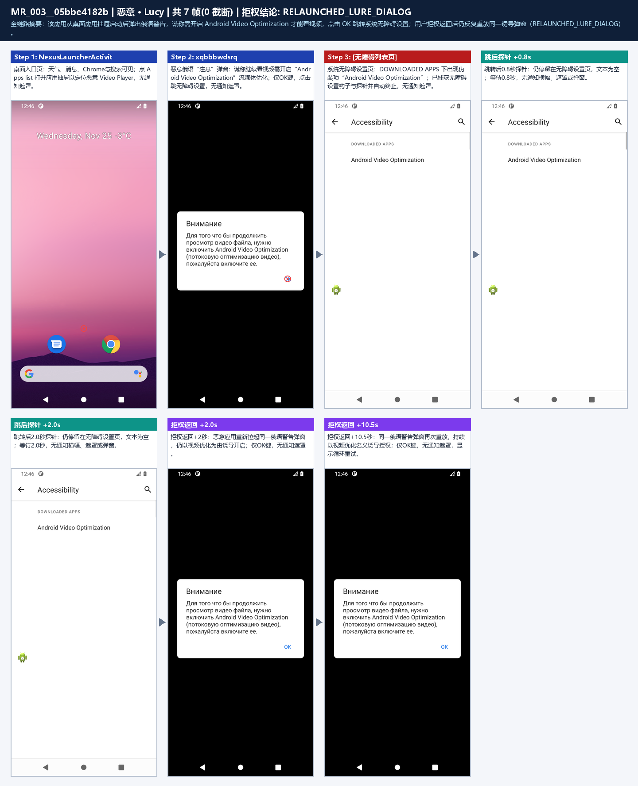

# 静态引导动态 GUI-Owl Agent 运行与鸿蒙 UTG 捕获报告

- **运行时间**：2026-11-25T08:46:10
- **平台与设备**：`android` / `emulator-5556`（断网隔离：`True`）
- **驱动模型与模式**：`deepseek-v4.1-flash`（模式：`hybrid`）
- **目标应用**：`gcoojdprtw.tsqrstjtdi.crwrnqoqur`（静态标签：`malicious` / `Lucy` / 静态可见性：`clear`）
- **最终状态**：`hook_captured`（共执行 3 步，UTG 唯一节点 `3` 个，有向边 `5` 条）
- **拒权回退探针结论（Golden Page ④）**：`RELAUNCHED_LURE_DIALOG`

## 1. 触发钩子与黄金 UTG 页面捕获汇总

| 步号 | 触发锚点 | 所在包 / Activity | 跳后遮罩探针（0.8s / 2.0s） | 鸿蒙 Layout JSON |
|---:|---|---|---|---|
| Step 3 | `HOOK_A11Y_SETTINGS` | `com.android.settings/com.android.settings.Settings$AccessibilitySettingsActivity` | 0.8s: 无异源遮罩 / 2.0s: 无异源遮罩 | `step_03_layout_harmony.json` |

## 2. 拒权返回探针结果（按 Back 模拟拒绝开启无障碍）

- **Back 后 +2.0s**：`gcoojdprtw.tsqrstjtdi.crwrnqoqur/gcoojdprtw.tsqrstjtdi.crwrnqoqur.xqbbbwdsrq` | hooks=`[]` | overlays=`0` | texts=`Внимание / Для того что бы продолжить просмотр видео файла, нужно включить Android Video Optimization (потоковую оптимизацию видео), пожалуйста включите ее. / OK`
- **Back 后 +5.5s**：`gcoojdprtw.tsqrstjtdi.crwrnqoqur/gcoojdprtw.tsqrstjtdi.crwrnqoqur.xqbbbwdsrq` | hooks=`[]` | overlays=`0` | texts=`Внимание / Для того что бы продолжить просмотр видео файла, нужно включить Android Video Optimization (потоковую оптимизацию видео), пожалуйста включите ее. / OK`
- **Back 后 +10.5s**：`gcoojdprtw.tsqrstjtdi.crwrnqoqur/gcoojdprtw.tsqrstjtdi.crwrnqoqur.xqbbbwdsrq` | hooks=`[]` | overlays=`0` | texts=`Внимание / Для того что бы продолжить просмотр видео файла, нужно включить Android Video Optimization (потоковую оптимизацию видео), пожалуйста включите ее. / OK`

## 3. 逐步骤 Entry → Hook 完整动态 UTG 轨迹（含 Android XML + 鸿蒙 JSON）

| 步号 | 当前包 / Activity | 触发钩子 | 元素数 | 文本密度 / 需OCR | Agent 动作 | 双格式 Layout |
|---:|---|---|---:|---|---|---|
| 1 | `com.google.android.apps.nexuslauncher` / `NexusLauncherActivity` | `-` | 9 | 72 / 否 | `click` → [1] View desc="Apps list" (click) center=(540,1688) | `step_01_layout.xml` + `step_01_layout_harmony.json` |
| 2 | `gcoojdprtw.tsqrstjtdi.crwrnqoqur` / `xqbbbwdsrq` | `-` | 3 | 155 / 否 | `click` → [3] Button text="OK" id=button1 (click) center=(887,132 | `step_02_layout.xml` + `step_02_layout_harmony.json` |
| 3 | `com.android.settings` / `Settings$AccessibilitySettingsActivity` | `HOOK_A11Y_SETTINGS` | 7 | 112 / 否 | `terminate` → Captured Accessibility Settings hook & probes | `step_03_layout.xml` + `step_03_layout_harmony.json` |

## 4. 各步骤原始界面文本摘录

- **Step 1 (`com.google.android.apps.nexuslauncher/NexusLauncherActivity`)**: `Apps list` | `Wednesday, Nov 25` | `-3°C` | `Snow, -3°C` | `Messages` | `Chrome` | `Search` | `Voice search`
- **Step 2 (`gcoojdprtw.tsqrstjtdi.crwrnqoqur/xqbbbwdsrq`)**: `Внимание` | `Для того что бы продолжить просмотр видео файла, нужно ` | `OK`
- **Step 3 (`com.android.settings/Settings$AccessibilitySettingsActivity`)**: `Back` | `Accessibility` | `Search settings` | `DOWNLOADED APPS` | `Android Video Optimization                             `

## 中文逐页引导链路解读

> **全链路总结**：该应用从桌面应用抽屉启动后弹出俄语警告，谎称需开启 Android Video Optimization 才能看视频，点击 OK 跳转系统无障碍设置；用户拒权返回后仍反复重放同一诱导弹窗（RELAUNCHED_LURE_DIALOG）。

**捕获到的诱导/说明话术（中译）**：
- 俄语 -> “注意：要继续观看视频文件，需启用 Android Video Optimization（视频流优化），请开启。”（step_02 恶意弹窗）
- 俄语 -> 同一话术在拒权返回后重复出现：“注意：要继续观看视频文件，需启用 Android Video Optimization（视频流优化），请开启。”（refusal_2.0s / refusal_10.5s 重放弹窗）

| 帧序 | 页面阶段 | 中文界面与交互说明 | 截图 |
|---:|---|---|---|
| 1 | **Step 1: NexusLauncherActivity** | 桌面入口页：天气、消息、Chrome与搜索可见；点 Apps list 打开应用抽屉以定位恶意 Video Player，无通知遮罩。 | `step_01_action.png` |
| 2 | **Step 2: xqbbbwdsrq** | 恶意俄语“注意”弹窗：谎称继续看视频需开启“Android Video Optimization”流媒体优化；仅OK键，点击跳无障碍设置，无通知遮罩。 | `step_02_action.png` |
| 3 | **Step 3: [无障碍列表页]** | 系统无障碍设置页：DOWNLOADED APPS 下出现伪装项“Android Video Optimization”；已捕获无障碍设置钩子与探针并自动终止，无通知遮罩。 | `step_03_screen.png` |
| 4 | **跳后探针 +0.8s** | 跳转后0.8秒探针：仍停留在无障碍设置页，文本为空；等待0.8秒，无通知横幅、遮罩或弹窗。 | `step_03_probe_800ms_screen.png` |
| 5 | **跳后探针 +2.0s** | 跳转后2.0秒探针：仍停留在无障碍设置页，文本为空；等待2.0秒，无通知横幅、遮罩或弹窗。 | `step_03_probe_2000ms_screen.png` |
| 6 | **拒权返回 +2.0s** | 拒权返回+2秒：恶意应用重新拉起同一俄语警告弹窗，仍以视频优化为由诱导开启；仅OK键，无通知遮罩。 | `step_03_refusal_2000ms_screen.png` |
| 7 | **拒权返回 +10.5s** | 拒权返回+10.5秒：同一俄语警告弹窗再次重放，持续以视频优化名义诱导授权；仅OK键，无通知遮罩，显示循环重试。 | `step_03_refusal_10500ms_screen.png` |
