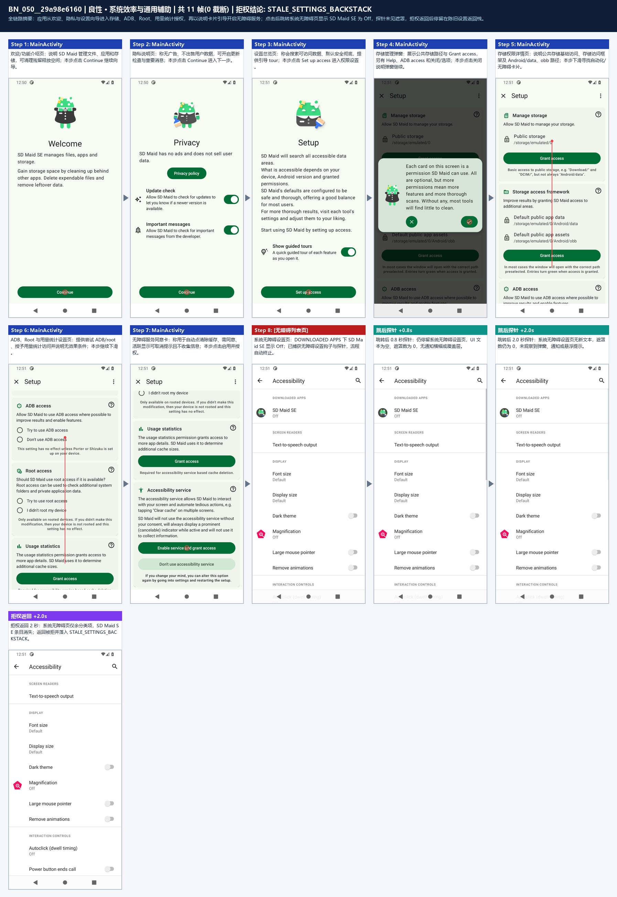

# 静态引导动态 GUI-Owl Agent 运行与鸿蒙 UTG 捕获报告

- **运行时间**：2026-11-25T08:50:51
- **平台与设备**：`android` / `emulator-5556`（断网隔离：`False`）
- **驱动模型与模式**：`deepseek-v4.1-flash`（模式：`hybrid`）
- **目标应用**：`eu.darken.sdmse`（静态标签：`benign` / `系统效率与通用辅助` / 静态可见性：`clear`）
- **最终状态**：`hook_captured`（共执行 8 步，UTG 唯一节点 `9` 个，有向边 `8` 条）
- **拒权回退探针结论（Golden Page ④）**：`RELAUNCHED_A11Y_SETTINGS`

## 1. 触发钩子与黄金 UTG 页面捕获汇总

| 步号 | 触发锚点 | 所在包 / Activity | 跳后遮罩探针（0.8s / 2.0s） | 鸿蒙 Layout JSON |
|---:|---|---|---|---|
| Step 8 | `HOOK_A11Y_SETTINGS` | `com.android.settings/com.android.settings.Settings$AccessibilitySettingsActivity` | 0.8s: 无异源遮罩 / 2.0s: 无异源遮罩 | `step_08_layout_harmony.json` |

## 2. 拒权返回探针结果（按 Back 模拟拒绝开启无障碍）

- **Back 后 +2.0s**：`com.android.settings/com.android.settings.Settings$AccessibilitySettingsActivity` | hooks=`['HOOK_A11Y_SETTINGS']` | overlays=`0` | texts=`Back / Accessibility / Search settings / SCREEN READERS / Text-to-speech output`

## 3. 逐步骤 Entry → Hook 完整动态 UTG 轨迹（含 Android XML + 鸿蒙 JSON）

| 步号 | 当前包 / Activity | 触发钩子 | 元素数 | 文本密度 / 需OCR | Agent 动作 | 双格式 Layout |
|---:|---|---|---:|---|---|---|
| 1 | `eu.darken.sdmse` / `MainActivity` | `-` | 5 | 160 / 否 | `click` → [5] TextView text="Continue" center=(540,2038) | `step_01_layout.xml` + `step_01_layout_harmony.json` |
| 2 | `eu.darken.sdmse` / `MainActivity` | `-` | 12 | 254 / 否 | `click` → [11] View (click) center=(540,2038) | `step_02_layout.xml` + `step_02_layout_harmony.json` |
| 3 | `eu.darken.sdmse` / `MainActivity` | `-` | 11 | 439 / 否 | `click` → [10] View (click) center=(540,2038) | `step_03_layout.xml` + `step_03_layout_harmony.json` |
| 4 | `eu.darken.sdmse` / `MainActivity` | `-` | 32 | 580 / 否 | `click` → [31] View (click) center=(912,1369) | `step_04_layout.xml` + `step_04_layout_harmony.json` |
| 5 | `eu.darken.sdmse` / `MainActivity` | `-` | 33 | 615 / 否 | `swipe` → [540, 1800] | `step_05_layout.xml` + `step_05_layout_harmony.json` |
| 6 | `eu.darken.sdmse` / `MainActivity` | `-` | 31 | 767 / 否 | `swipe` → [540, 1900] | `step_06_layout.xml` + `step_06_layout_harmony.json` |
| 7 | `eu.darken.sdmse` / `MainActivity` | `-` | 26 | 896 / 否 | `click` → [15] View (click) center=(540,1752) | `step_07_layout.xml` + `step_07_layout_harmony.json` |
| 8 | `com.android.settings` / `Settings$AccessibilitySettingsActivity` | `HOOK_A11Y_SETTINGS` | 32 | 209 / 否 | `terminate` → Captured Accessibility Settings hook & probes | `step_08_layout.xml` + `step_08_layout_harmony.json` |

## 4. 各步骤原始界面文本摘录

- **Step 1 (`eu.darken.sdmse/MainActivity`)**: `Welcome` | `SD Maid SE manages files, apps and storage.` | `Gain storage space by cleaning up behind other apps. De` | `Continue`
- **Step 2 (`eu.darken.sdmse/MainActivity`)**: `Privacy` | `SD Maid has no ads and does not sell user data.` | `Privacy policy` | `Update check` | `Allow SD Maid to check for updates to let you know if a` | `Important messages` | `Allow SD Maid to check for important messages from the ` | `Continue`
- **Step 3 (`eu.darken.sdmse/MainActivity`)**: `Setup` | `SD Maid will search all accessible data areas.` | `What is accessible depends on your device, Android vers` | `SD Maid's defaults are configured to be safe and thorou` | `For more thorough results, visit each tool's settings a` | `Start using SD Maid by setting up access.` | `Show guided tours` | `A quick guided tour of each feature as you open it.` | `Set up access`
- **Step 4 (`eu.darken.sdmse/MainActivity`)**: `Manage storage` | `Allow SD Maid to manage your storage.` | `Public storage` | `/storage/emulated/0` | `Grant access` | `Help` | `Default public app assets` | `/storage/emulated/0/Android/obb` | `In most cases the window will open with the correct pat` | `ADB access`
- **Step 5 (`eu.darken.sdmse/MainActivity`)**: `Manage storage` | `Allow SD Maid to manage your storage.` | `Public storage` | `/storage/emulated/0` | `Grant access` | `Basic access to public storage, e.g. "Download/" and "D` | `Help` | `Storage access framework` | `Improve results by granting SD Maid access to additiona` | `Default public app data`
- **Step 6 (`eu.darken.sdmse/MainActivity`)**: `ADB access` | `Allow SD Maid to use ADB access where possible to impro` | `Try to use ADB access` | `Don't use ADB access` | `This setting has no effect unless Porter or Shizuku is ` | `Help` | `Root access` | `Should SD Maid use root access if it is available? Root` | `Try to use root access` | `I didn't root my device`
- **Step 7 (`eu.darken.sdmse/MainActivity`)**: `I didn't root my device` | `Only available on rooted devices. If you didn't make th` | `Usage statistics` | `The usage statistics permission grants access to more a` | `Grant access` | `Required for accessibility service based cache deletion` | `Help` | `Accessibility service` | `The accessibility service allows SD Maid to interact wi` | `SD Maid will not use the accessibility service without `
- **Step 8 (`com.android.settings/Settings$AccessibilitySettingsActivity`)**: `Back` | `Accessibility` | `Search settings` | `DOWNLOADED APPS` | `SD Maid SE` | `Off` | `SCREEN READERS` | `Text-to-speech output` | `DISPLAY` | `Font size`

## 中文逐页引导链路解读

> **全链路总结**：应用从欢迎、隐私与设置向导进入存储、ADB、Root、用量统计授权，再以说明卡片引导开启无障碍服务；点击后跳转系统无障碍页显示 SD Maid SE 为 Off，探针未见遮罩，拒权返回后停留在陈旧设置返回栈。

**捕获到的诱导/说明话术（中译）**：
- Gain storage space by cleaning up behind other apps. -> 通过清理其他应用残留获得存储空间（欢迎页）
- SD Maid has no ads and does not sell user data. -> 无广告且不出售用户数据（隐私页）
- Required for accessibility service based cache deletion. -> 基于无障碍服务的缓存删除所必需（权限设置页）
- The accessibility service allows SD Maid to interact with your screen and automate tedious actions. -> 无障碍服务可代点清除缓存等繁琐操作（无障碍同意卡）
- SD Maid will not use the accessibility service without your consent... will not use it to collect information. -> 未经同意不使用、活跃时显示可取消提示且不收集信息（无障碍同意卡）
- Enable service and grant access -> 启用服务并授予访问（无障碍同意卡）
- If you change your mind, you can alter this option again by going into settings and restarting the setup. -> 可稍后在设置重启向导修改（无障碍同意卡）

| 帧序 | 页面阶段 | 中文界面与交互说明 | 截图 |
|---:|---|---|---|
| 1 | **Step 1: MainActivity** | 欢迎/功能介绍页：说明 SD Maid 管理文件、应用和存储，可清理残留释放空间；本步点击 Continue 继续向导。 | `step_01_action.png` |
| 2 | **Step 2: MainActivity** | 隐私说明页：称无广告、不出售用户数据，可开启更新检查与重要消息；本步点击 Continue 进入下一步。 | `step_02_action.png` |
| 3 | **Step 3: MainActivity** | 设置总览页：称会搜索可访问数据、默认安全彻底，提供引导 tour；本步点击 Set up access 进入权限设置。 | `step_03_action.png` |
| 4 | **Step 4: MainActivity** | 存储管理弹窗：展示公共存储路径与 Grant access，另有 Help、ADB access 和关闭/选项；本步点击关闭说明弹窗继续。 | `step_04_action.png` |
| 5 | **Step 5: MainActivity** | 存储权限详情页：说明公共存储基础访问、存储访问框架及 Android/data、obb 路径；本步下滑寻找自动化/无障碍卡片。 | `step_05_action.png` |
| 6 | **Step 6: MainActivity** | ADB、Root 与用量统计设置页：提供尝试 ADB/root、授予用量统计访问并说明无效果条件；本步继续下滑。 | `step_06_action.png` |
| 7 | **Step 7: MainActivity** | 无障碍服务同意卡：称用于自动点清除缓存、需同意、活跃显示可取消提示且不收集信息；本步点击启用并授权。 | `step_07_action.png` |
| 8 | **Step 8: [无障碍列表页]** | 系统无障碍设置页：DOWNLOADED APPS 下 SD Maid SE 显示 Off；已捕获无障碍设置钩子与探针，流程自动终止。 | `step_08_screen.png` |
| 9 | **跳后探针 +0.8s** | 跳转后 0.8 秒探针：仍停留系统无障碍设置页，UI 文本为空、遮罩数为 0，无通知横幅或覆盖层。 | `step_08_probe_800ms_screen.png` |
| 10 | **跳后探针 +2.0s** | 跳转后 2.0 秒探针：系统无障碍设置页无新文本，遮罩数仍为 0，未观察到弹窗、通知或悬浮提示。 | `step_08_probe_2000ms_screen.png` |
| 11 | **拒权返回 +2.0s** | 拒权返回 2 秒：系统无障碍页仅余分类项，SD Maid SE 条目消失；返回被拒并落入 STALE_SETTINGS_BACKSTACK。 | `step_08_refusal_2000ms_screen.png` |
