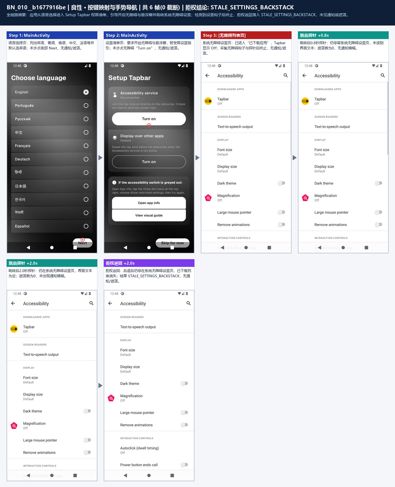

# 静态引导动态 GUI-Owl Agent 运行与鸿蒙 UTG 捕获报告

- **运行时间**：2026-11-25T08:48:01
- **平台与设备**：`android` / `emulator-5556`（断网隔离：`False`）
- **驱动模型与模式**：`deepseek-v4.1-flash`（模式：`hybrid`）
- **目标应用**：`com.earendel.tapbar`（静态标签：`benign` / `按键映射与手势导航` / 静态可见性：`clear`）
- **最终状态**：`hook_captured`（共执行 3 步，UTG 唯一节点 `4` 个，有向边 `3` 条）
- **拒权回退探针结论（Golden Page ④）**：`RELAUNCHED_A11Y_SETTINGS`

## 1. 触发钩子与黄金 UTG 页面捕获汇总

| 步号 | 触发锚点 | 所在包 / Activity | 跳后遮罩探针（0.8s / 2.0s） | 鸿蒙 Layout JSON |
|---:|---|---|---|---|
| Step 3 | `HOOK_A11Y_SETTINGS` | `com.android.settings/com.android.settings.Settings$AccessibilitySettingsActivity` | 0.8s: 无异源遮罩 / 2.0s: 无异源遮罩 | `step_03_layout_harmony.json` |

## 2. 拒权返回探针结果（按 Back 模拟拒绝开启无障碍）

- **Back 后 +2.0s**：`com.android.settings/com.android.settings.Settings$AccessibilitySettingsActivity` | hooks=`['HOOK_A11Y_SETTINGS']` | overlays=`0` | texts=`Back / Accessibility / Search settings / SCREEN READERS / Text-to-speech output`

## 3. 逐步骤 Entry → Hook 完整动态 UTG 轨迹（含 Android XML + 鸿蒙 JSON）

| 步号 | 当前包 / Activity | 触发钩子 | 元素数 | 文本密度 / 需OCR | Agent 动作 | 双格式 Layout |
|---:|---|---|---:|---|---|---|
| 1 | `com.earendel.tapbar` / `MainActivity` | `-` | 38 | 84 / 否 | `click` → [37] View (click) center=(907,2120) | `step_01_layout.xml` + `step_01_layout_harmony.json` |
| 2 | `com.earendel.tapbar` / `MainActivity` | `-` | 12 | 443 / 否 | `click` → [540, 754] | `step_02_layout.xml` + `step_02_layout_harmony.json` |
| 3 | `com.android.settings` / `Settings$AccessibilitySettingsActivity` | `HOOK_A11Y_SETTINGS` | 32 | 205 / 否 | `terminate` → Captured Accessibility Settings hook & probes | `step_03_layout.xml` + `step_03_layout_harmony.json` |

## 4. 各步骤原始界面文本摘录

- **Step 1 (`com.earendel.tapbar/MainActivity`)**: `Choose language` | `English` | `Português` | `Русский` | `中文` | `Français` | `Deutsch` | `हिन्दी` | `日本語` | `한국어`
- **Step 2 (`com.earendel.tapbar/MainActivity`)**: `Setup Tapbar` | `Accessibility service. Lets the tap zone sit directly o` | `Display over other apps. Draws the tap zone below the s` | `If the accessibility switch is greyed out:` | `Open App info, tap the three-dot menu at the top right,` | `Open app info` | `View visual guide` | `Skip for now`
- **Step 3 (`com.android.settings/Settings$AccessibilitySettingsActivity`)**: `Back` | `Accessibility` | `Search settings` | `DOWNLOADED APPS` | `Tapbar` | `Off` | `SCREEN READERS` | `Text-to-speech output` | `DISPLAY` | `Font size`

## 中文逐页引导链路解读

> **全链路总结**：应用从语言选择进入 Setup Tapbar 权限清单，引导开启无障碍与悬浮窗并跳转系统无障碍设置；检测到设置钩子后终止，拒权返回落入 STALE_SETTINGS_BACKSTACK，未见通知或遮罩。

**捕获到的诱导/说明话术（中译）**：
- Accessibility service. Lets the tap zone sit directly on the status bar. It does not read or send any screen text.. Turn on -> 无障碍服务可让点击区直接位于状态栏上，且不会读取或发送任何屏幕文字；并提供“开启”。（Step 2 设置清单）
- Display over other apps. Draws the tap zone below the status bar when the Accessibility service is not active.. Turn on -> 悬浮窗权限用于在无障碍服务未启用时于状态栏下方绘制点击区；并提供“开启”。（Step 2 设置清单）
- If the accessibility switch is greyed out: Open App info, tap the three-dot menu at the top right, choose Allow restricted settings, then try again. -> 若无障碍开关变灰：打开应用信息，点右上角三点菜单，选择“允许受限设置”后重试。（Step 2 设置清单）

| 帧序 | 页面阶段 | 中文界面与交互说明 | 截图 |
|---:|---|---|---|
| 1 | **Step 1: MainActivity** | 语言选择页：列出英语、葡语、俄语、中文、法语等并默认选英语；本步点底部 Next，无通知/遮罩。 | `step_01_action.png` |
| 2 | **Step 2: MainActivity** | 设置清单页：要求开启无障碍与悬浮窗，附受限设置指引；本步点无障碍“Turn on”，无通知/遮罩。 | `step_02_action.png` |
| 3 | **Step 3: [无障碍列表页]** | 系统无障碍设置页：已进入“已下载应用”，Tapbar 显示 Off；采集无障碍钩子与探针后终止，无通知/遮罩。 | `step_03_screen.png` |
| 4 | **跳后探针 +0.8s** | 跳转后0.8秒探针：仍停留系统无障碍设置页，未读到界面文本；遮罩数为0，无通知横幅。 | `step_03_probe_800ms_screen.png` |
| 5 | **跳后探针 +2.0s** | 跳转后2.0秒探针：仍在系统无障碍设置页，界面文本为空；遮罩数为0，未出现通知横幅。 | `step_03_probe_2000ms_screen.png` |
| 6 | **拒权返回 +2.0s** | 拒权返回：后退后仍停在系统无障碍设置页，已下载列表消失；结果 STALE_SETTINGS_BACKSTACK，无通知/遮罩。 | `step_03_refusal_2000ms_screen.png` |
